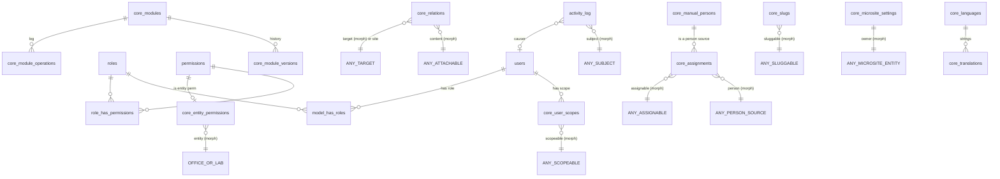

# Database Design
## DB-01 — Conventions, Kernel ও System Core Tables

| বিষয় | তথ্য |
|---|---|
| Document | Database Design DB-01 |
| Version | 0.1 (Draft) |
| Date | 2026-10-08 |
| Status | ✔ Confirmed |
| Based on | [SRS v1.0](../02-SRS/00-SRS-Overview.md), [SAD Part A](../03-SAD/01-SAD-PartA-Foundation.md), [SAD Part B](../03-SAD/02-SAD-PartB-Engines-Runtime.md), `project_diu` |
| Covers | C-01 Module Manager, C-02 User, C-03 Role / Permission / Scope, C-04 Activity Log, C-05 Settings, C-13 Relation Engine (Relation, Assignment, Manual Person), C-15 Localization, Slug (ADR-11), Microsite Settings (P-09) |

### Database Design-এর গঠন

| Doc | বিষয় | Status |
|---|---|---|
| **DB-01** | Conventions + Kernel ও System core table | **এই document** |
| DB-02 | Site-building core: Media, Menu, Header / Footer, Homepage, Pages, SEO & Redirect, Taxonomy, Search, Notification, Backup, Statistics, API, Theme — [02-DB-Core-SiteBuilding.md](02-DB-Core-SiteBuilding.md) | ✔ Confirmed |
| DB-03 | Academic module (M-01 থেকে M-11) — [03-DB-Academic.md](03-DB-Academic.md) | ✔ Confirmed |
| DB-04 | People module (M-12 থেকে M-17) — [04-DB-People.md](04-DB-People.md) | ✔ Confirmed |
| DB-05 | Content module (M-18 থেকে M-30) — [05-DB-Content.md](05-DB-Content.md) | ✔ Confirmed |
| DB-06 | Services, Reputation, Communication (M-31 থেকে M-39) — [06-DB-Services.md](06-DB-Services.md) | ✔ Confirmed |

---

## 1. Conventions (সব DB document-এ প্রযোজ্য)

### 1.1 Table-এর শ্রেণী

প্রতিটি table-এর পাশে তার শ্রেণী লেখা থাকবে; শ্রেণী ঠিক করে কোন standard column থাকবে।

| শ্রেণী | কী | Standard column | উদাহরণ |
|---|---|---|---|
| **B** — Business | Admin যা তৈরি / পরিবর্তন / মুছে ফেলে | `id`, `is_active`, `created_by`, `updated_by`, `deleted_by`, `created_at`, `updated_at`, `deleted_at` (`$table->platformColumns()`) | users, news_posts |
| **C** — Configuration | Setting-ধরনের; মুছে ফেলার ধারণা নেই বা অন্যভাবে নিয়ন্ত্রিত | `id`, `created_at`, `updated_at` (+ প্রয়োজনে `is_active`, `updated_by`) | core_settings, core_languages |
| **P** — Pivot / Relation | দুই record-এর সংযোগ (SRS Q-06) | `created_at`, `updated_at` (+ প্রয়োজনে `created_by`) | core_relations, core_user_scopes |
| **S** — System | Framework / kernel-এর অভ্যন্তরীণ | Package / kernel অনুযায়ী | sessions, core_modules |
| **L** — Log | শুধু insert, read-only | `id`, `created_at` | activity_log |

### 1.2 Data Type Convention

| ধরন | MySQL type | নিয়ম |
|---|---|---|
| Primary key | `BIGINT UNSIGNED AUTO_INCREMENT` | সব table-এ `id` (pivot-এ composite unique) |
| Foreign key / reference | `BIGINT UNSIGNED` | নাম `{entity}_id`; FK নীতি SAD Part A 6.6 |
| Morph type | `VARCHAR(100)` | Morph alias (`department.department`), class নাম নয় (ADR-17) |
| Morph id | `BIGINT UNSIGNED` | — |
| Translatable text | `JSON` | `{"en": "...", "bn": "..."}` (spatie/laravel-translatable) |
| ছোট text | `VARCHAR(n)` | n যথাসম্ভব বাস্তবসম্মত (নাম 191, title 255, URL 2048 → `TEXT`) |
| বড় text / rich text | `LONGTEXT` (অথবা translatable হলে `JSON`) | — |
| Boolean | `TINYINT(1)` | `is_*` / `has_*` নাম |
| Enum-ধরনের | `VARCHAR(30)` + application enum | MySQL `ENUM` নয় (পরিবর্তনে migration লাগে) |
| তারিখ / সময় | `TIMESTAMP` (UTC) / `DATE` | Display-এ timezone setting (Asia/Dhaka) |
| টাকা | `DECIMAL(12,2)` | Float নয় |
| JSON settings | `JSON` | Schema application-এ validate |

### 1.3 Charset ও Engine

`utf8mb4` / `utf8mb4_unicode_ci` (বাংলা সমর্থন), InnoDB, `ROW_FORMAT=DYNAMIC`।

### 1.4 Data Dictionary-র Column সংক্ষেপ

| চিহ্ন | অর্থ |
|---|---|
| PK / FK / UQ / IX | Primary key / Foreign key / Unique / Index |
| N | Nullable |
| T | Translatable (JSON) |
| ⚙ | `platformColumns()` থেকে আসা standard column (আলাদা করে লেখা হয়নি): `is_active`, `created_by`, `updated_by`, `deleted_by`, `created_at`, `updated_at`, `deleted_at`, `active_key` (DB-02 Section 1.3) |

---

## 2. Kernel ERD (এই document-এর table)

---

## 3. C-01 Module Manager

### 3.1 `core_modules` — S

Module-এর status (custom nwidart activator-এর storage, ADR-02)।

| Column | Type | Key / N | Default | বর্ণনা |
|---|---|---|---|---|
| id | BIGINT UNSIGNED | PK | | |
| slug | VARCHAR(100) | UQ | | `uwms.slug` |
| name | VARCHAR(100) | UQ | | nwidart `name` (folder) |
| type | VARCHAR(20) | IX | | `core` / `installable` |
| version | VARCHAR(30) | | | বর্তমান version |
| status | VARCHAR(20) | IX | `installed` | `installed` (inactive) / `active` / `failed` |
| is_bundled | TINYINT(1) | | 0 | Repository-র সাথে আসা কিনা (ZIP নয়) |
| source_path | VARCHAR(255) | | | `Modules/{Name}` বা `shared/modules-runtime/{Name}` (ADR-12) |
| manifest | JSON | | | `module.json`-এর snapshot |
| installed_at | TIMESTAMP | N | | |
| activated_at | TIMESTAMP | N | | |
| installed_by | BIGINT UNSIGNED | N, FK users (set null) | | |
| created_at, updated_at | TIMESTAMP | | | |

### 3.2 `core_module_versions` — L

| Column | Type | Key / N | বর্ণনা |
|---|---|---|---|
| id | BIGINT UNSIGNED | PK | |
| module_id | BIGINT UNSIGNED | FK core_modules (cascade), IX | |
| from_version | VARCHAR(30) | N | Install-এ null |
| to_version | VARCHAR(30) | | |
| backup_path | VARCHAR(255) | N | পুরনো folder ও DB backup-এর অবস্থান |
| performed_by | BIGINT UNSIGNED | N, FK users | |
| created_at | TIMESTAMP | IX | |

### 3.3 `core_module_operations` — L

Install / activate / deactivate / update / uninstall-এর ধাপভিত্তিক log (FR-MODM-12)।

| Column | Type | Key / N | বর্ণনা |
|---|---|---|---|
| id | BIGINT UNSIGNED | PK | |
| module_slug | VARCHAR(100) | IX | Module row না থাকলেও (ব্যর্থ install) log রাখতে slug |
| operation | VARCHAR(20) | | install / activate / deactivate / update / uninstall |
| status | VARCHAR(20) | IX | running / success / failed / rolled_back |
| steps | JSON | | `[{step, status, message, at}]` |
| error | TEXT | N | |
| performed_by | BIGINT UNSIGNED | N, FK users | |
| started_at, finished_at | TIMESTAMP | N | |

---

## 4. C-02 User Management

### 4.1 `users` — B

Laravel default table, extend করা।

| Column | Type | Key / N | Default | বর্ণনা |
|---|---|---|---|---|
| id | BIGINT UNSIGNED | PK | | |
| name | VARCHAR(191) | | | |
| username | VARCHAR(60) | UQ, N | | বর্তমান DIU-তে আছে |
| email | VARCHAR(191) | UQ | | BRL-USER-01 |
| email_verified_at | TIMESTAMP | N | | |
| password | VARCHAR(255) | | | Hash |
| phone | VARCHAR(30) | N | | |
| locale | VARCHAR(10) | | `en` | Admin interface ভাষা (FR-GEN-85) |
| timezone | VARCHAR(50) | N | | Null → site default |
| app_authentication_secret | TEXT | N | | Filament MFA (TOTP) secret, encrypted |
| app_authentication_recovery_codes | TEXT | N | | Encrypted |
| invited_at | TIMESTAMP | N | | FR-USER-07 |
| last_login_at | TIMESTAMP | N, IX | | FR-USER-08 |
| last_login_ip | VARCHAR(45) | N | | IPv6 সহ |
| remember_token | VARCHAR(100) | N | | |
| ⚙ | | | | `is_active` (FR-USER-05), blame, timestamps, `deleted_at` |

* Avatar: Media usage (P-13, DB-02), column নয়।
* MFA column-এর চূড়ান্ত নাম Filament 5-এর MFA documentation অনুযায়ী POC-তে নিশ্চিত করা হবে।

### 4.2 Laravel System Table — S

`password_reset_tokens`, `sessions` (Redis session হলে ঐচ্ছিক), `cache`, `jobs`, `job_batches`, `failed_jobs` — Laravel 13 default migration অনুযায়ী, পরিবর্তন নেই।

---

## 5. C-03 Role, Permission ও Scope

### 5.1 Shield / spatie Table — S

`roles`, `permissions`, `model_has_roles`, `model_has_permissions`, `role_has_permissions` — spatie/laravel-permission-এর default migration; Shield আলাদা table যোগ করে না। পরিবর্তন:

| Table | যোগ করা column | কারণ |
|---|---|---|
| permissions | `module_slug VARCHAR(100) N, IX` | Module uninstall-এ permission মুছে ফেলা ও inactive module-এর permission ধূসর দেখানো (FR-ROLE-02/03) |
| permissions | `kind VARCHAR(20)` (`resource` / `page` / `widget` / `custom` / `entity`) | Role UI-তে group করা (SAD Part A 7.4) |
| roles | `description VARCHAR(255) N`, `is_system TINYINT(1) DEFAULT 0` | Default role (FR-ROLE-04) মুছে ফেলা থেকে রক্ষা |

### 5.2 `core_entity_permissions` — P (P-10)

Dynamic entity permission (`Manage:Office#12`) কোন entity-র তা নির্দেশ করে (FR-ROLE-07)।

| Column | Type | Key / N | বর্ণনা |
|---|---|---|---|
| permission_id | BIGINT UNSIGNED | PK, FK permissions (cascade) | |
| entity_type | VARCHAR(100) | IX (entity_type, entity_id) | `office.office` / `lab.lab` |
| entity_id | BIGINT UNSIGNED | | |
| action | VARCHAR(30) | | manage / content / menu |
| created_at, updated_at | TIMESTAMP | | |

UQ: `(entity_type, entity_id, action)`।
Entity permanent delete → listener permission মুছে ফেলে → cascade এই row মুছে দেয়।

### 5.3 `core_user_scopes` — P (P-03)

| Column | Type | Key / N | বর্ণনা |
|---|---|---|---|
| user_id | BIGINT UNSIGNED | FK users (cascade) | |
| scopeable_type | VARCHAR(100) | | `faculty.faculty` / `department.department` / `program.program` |
| scopeable_id | BIGINT UNSIGNED | | |
| created_by | BIGINT UNSIGNED | N, FK users (set null) | |
| created_at, updated_at | TIMESTAMP | | |

PK / UQ: `(user_id, scopeable_type, scopeable_id)`; IX: `(scopeable_type, scopeable_id)` (কোন entity-তে কারা আছেন — notification recipient-এর জন্য, FR-NOTI-07)।

---

## 6. C-04 Activity / Audit Log

### 6.1 `activity_log` — L

spatie/laravel-activitylog-এর default table, extend করা (custom Activity model)।

| Column | Type | Key / N | বর্ণনা |
|---|---|---|---|
| id | BIGINT UNSIGNED | PK | |
| log_name | VARCHAR(50) | IX, N | `model` / `auth` / `system` |
| description | TEXT | | |
| event | VARCHAR(30) | N, IX | created / updated / deleted / restored / force_deleted / activated / deactivated / login / logout / login_failed ... |
| subject_type, subject_id | VARCHAR(100), BIGINT UNSIGNED | N, IX (subject_type, subject_id) | কোন record (FR-GEN-83 Activity tab) |
| causer_type, causer_id | VARCHAR(100), BIGINT UNSIGNED | N, IX (causer_type, causer_id) | কে |
| properties | JSON | N | `{old: {...}, attributes: {...}}` শুধু পরিবর্তিত field (FR-GEN-91) |
| batch_uuid | CHAR(36) | N, IX | একসাথে হওয়া পরিবর্তন |
| module_slug | VARCHAR(100) | N, IX | *যোগ করা* — module filter (FR-LOG-04) |
| ip_address | VARCHAR(45) | N | *যোগ করা* (BR-LOG-04) |
| user_agent | VARCHAR(512) | N | *যোগ করা* |
| created_at | TIMESTAMP | IX | Retention cleanup (FR-LOG-07) |
| updated_at | TIMESTAMP | | Package-এর প্রয়োজনে; application কখনো update করে না (FR-LOG-09) |

* Failed login-এ causer null, চেষ্টা করা email `properties`-এ (password কখনো নয়)।
* Database-স্তরে read-only নিশ্চয়তা: application DB user-এর এই table-এ `UPDATE` অনুমতি না দেওয়া (cleanup job আলাদা DB user / `DELETE` শুধু) — Deployment Plan-এ।

### 6.2 Retention Setting

`core_settings` → `activity-log.retention_days` (≥ 60, default 90), `activity-log.archive_enabled` (BRL-LOG-01)।

---

## 7. C-05 Website Settings

### 7.1 `core_settings` — C

| Column | Type | Key / N | Default | বর্ণনা |
|---|---|---|---|---|
| id | BIGINT UNSIGNED | PK | | |
| group | VARCHAR(100) | | | `general`, `contact`, `social`, `media`, `mail`, `seo`, অথবা module slug (FR-SET-10) |
| key | VARCHAR(150) | | | `site_name` |
| value | JSON | N | | Translatable হলে `{"en": "...", "bn": "..."}` |
| is_translatable | TINYINT(1) | | 0 | |
| is_encrypted | TINYINT(1) | | 0 | SMTP password ইত্যাদি |
| is_public | TINYINT(1) | | 1 | Frontend-এ পড়া যাবে কিনা (API / view) |
| updated_by | BIGINT UNSIGNED | N, FK users (set null) | | |
| created_at, updated_at | TIMESTAMP | | | |

UQ: `(group, key)`।

* Module uninstall (data সহ) → সেই module-এর `group` row মুছে যায়।
* Settings পরিবর্তনের ইতিহাস activity log-এ (C শ্রেণী, তাই soft delete নেই — BRL-SET-01)।

---

## 8. C-13 Content Relation Engine

### 8.1 `core_relations` — P (P-01)

SAD Part B Section 3।

| Column | Type | Key / N | Default | বর্ণনা |
|---|---|---|---|---|
| id | BIGINT UNSIGNED | PK | | Highlight update সহজ করতে surrogate key |
| content_type | VARCHAR(100) | | | Attachable alias |
| content_id | BIGINT UNSIGNED | | | |
| target_type | VARCHAR(100) | | | Target alias, অথবা `site` |
| target_id | BIGINT UNSIGNED | | | `site` হলে `0` — `site:0` row = content main site-এ প্রকাশিত (শুধু Admin; DB-05 Section 1) |
| is_highlighted | TINYINT(1) | | 0 | FR-CNT-H01 |
| highlight_order | SMALLINT UNSIGNED | | 0 | |
| highlight_until | TIMESTAMP | N | | FR-CNT-H03 |
| created_by | BIGINT UNSIGNED | N, FK users (set null) | | |
| created_at, updated_at | TIMESTAMP | | | |

| Index | Column | উদ্দেশ্য |
|---|---|---|
| UQ | `(content_type, content_id, target_type, target_id)` | Duplicate নেই; content → targets |
| IX | `(target_type, target_id, content_type)` | Target → contents (microsite listing) |
| IX | `(target_type, target_id, content_type, is_highlighted, highlight_order)` | Homepage highlight query (IX-7) |
| IX | `(is_highlighted, highlight_until)` | Hourly expiry job |

### 8.1.1 `core_main_site_requests` — L (P-23)

Entity user-এর "Main site-এ দেখানোর অনুরোধ" (SRS FR-CNT-H09, UI/UX UXQ-02)। প্রকাশের সিদ্ধান্ত Admin-এর (`core_relations`-এর `site:0` row)।

| Column | Type | Key / N | Default | বর্ণনা |
|---|---|---|---|---|
| id | BIGINT UNSIGNED | PK | | |
| content_type, content_id | VARCHAR(100), BIGINT UNSIGNED | | | Attachable content |
| requested_by | BIGINT UNSIGNED | FK users (set null), N | | |
| requested_at | TIMESTAMP | | | |
| decision | VARCHAR(10) | IX | `pending` | `pending` / `published` / `dismissed` |
| decided_by | BIGINT UNSIGNED | N, FK users (set null) | | |
| decided_at | TIMESTAMP | N | | |

UQ: `(content_type, content_id, decision)` — একটি content-এর একসাথে একটিই pending অনুরোধ (application নিশ্চিত করে)। IX: `(decision, requested_at)` (Main Site Queue)। Admin `site:0` তৈরি করলে `published`, Queue থেকে dismiss করলে `dismissed`।

### 8.2 `core_assignments` — B (P-02)

Assignment-এ নিজস্ব business data (ভূমিকা, ক্রম, মেয়াদ) আছে, তাই B শ্রেণী (SRS BRL-COM-02-এর মতো)।

| Column | Type | Key / N | Default | বর্ণনা |
|---|---|---|---|---|
| id | BIGINT UNSIGNED | PK | | |
| person_type | VARCHAR(100) | | | `faculty-member.profile`, `administration.member`, `alumni.alumni`, `core.manual-person` |
| person_id | BIGINT UNSIGNED | | | |
| assignable_type | VARCHAR(100) | | | `office.office`, `committee.committee`, `event.event` ... |
| assignable_id | BIGINT UNSIGNED | | | |
| role_key | VARCHAR(50) | IX | | **Standard Role Catalog**-এর key (Section 8.4) — যেমন `dean`, `head`, `officer`, `coordinator` |
| role_label | JSON | N, T | | এই ব্যক্তির জন্য প্রদর্শনের ভূমিকা override (যেমন "Professor & Head"); null হলে catalog-এর label |
| sort_order | INT UNSIGNED | | 0 | |
| starts_on | DATE | N | | |
| ends_on | DATE | N | | অতীত হলে "Former" (BRL-REL-06) |
| is_public | TINYINT(1) | | 1 | |
| overrides | JSON | N | | `{phone, extension, email}` assignment-ভিত্তিক |
| note | JSON | N, T | | Assignment-ভিত্তিক মন্তব্য, যেমন Committee member-এর "Nominated by UGC" (DB-04 থেকে যোগ) |
| ⚙ | | | | `is_active`, blame, timestamps, `deleted_at` |

| Index | Column | উদ্দেশ্য |
|---|---|---|
| IX | `(assignable_type, assignable_id, role_key, sort_order)` | Target-এর people তালিকা |
| IX | `(person_type, person_id)` | একজন ব্যক্তির সব assignment (profile page, cleanup) |
| IX | `(ends_on)` | Current / Former |

### 8.3 `core_manual_persons` — B (ADR-14)

| Column | Type | Key / N | বর্ণনা |
|---|---|---|---|
| id | BIGINT UNSIGNED | PK | |
| name | JSON | T | |
| designation | JSON | N, T | |
| organization | JSON | N, T | যেমন "Nominated by UGC" |
| email | VARCHAR(191) | N | |
| phone | VARCHAR(30) | N | |
| profile_url | VARCHAR(2048) | N | |
| ⚙ | | | |

Photo: Media usage (P-13)।

### 8.4 Standard Role Catalog — `core_assignment_roles` — C

**উদ্দেশ্য:** একাধিক university একই system ব্যবহার করবে, তাই ভূমিকার **key** সব জায়গায় একই ও স্থির থাকবে (data, report, migration, API একই রকম); প্রতিটি university শুধু **label** নিজের মতো বদলাবে। যেমন কোনো university-তে Department-এর "Head"-কে "Chairperson" বলা হয় — key `head`-ই থাকে, label বদলায়।

| Column | Type | Key / N | Default | বর্ণনা |
|---|---|---|---|---|
| id | BIGINT UNSIGNED | PK | | |
| assignable_type | VARCHAR(100) | | | কোন Assignable-এর ভূমিকা (`department.department`) |
| role_key | VARCHAR(50) | | | স্থির key (snake_case) — module register করে, পরিবর্তন অযোগ্য |
| label | JSON | T | | Admin পরিবর্তন করতে পারবেন ("Head" → "Chairperson") |
| is_single_holder | TINYINT(1) | | 0 | একসাথে একজন (যেমন Dean, Head) — দ্বিতীয়জন assign করলে আগের জনের `ends_on` set করার প্রস্তাব |
| sort_order | SMALLINT UNSIGNED | | 0 | People তালিকায় ভূমিকার ক্রম (Dean আগে, Officer পরে) |
| is_active | TINYINT(1) | | 1 | |
| created_at, updated_at | TIMESTAMP | | | |

UQ: `(assignable_type, role_key)`। Module install / activate-এ registry থেকে seed হয় (নতুন key যোগ হয়, বিদ্যমান label অক্ষত থাকে)।

**প্রাথমিক Catalog (key — default label):**

| Assignable | Role (ক্রম অনুযায়ী) |
|---|---|
| Faculty | `dean` — Dean ★, `associate_dean` — Associate Dean, `officer` — Officer, `contact` — Contact |
| Department | `head` — Head ★, `coordinator` — Coordinator, `officer` — Officer, `industry_expert` — Industry Expert, `contact` — Contact |
| Program | `coordinator` — Program Coordinator, `officer` — Officer |
| Office | `head` — Head ★, `team` — Team |
| Office Section | `head` — Section Head ★, `team` — Team |
| Office Service | `responsible` — Responsible Person |
| Office Support Contact | `contact` — Contact Person |
| Lab | `in_charge` — In-charge ★, `member` — Member |
| Committee | `chairperson` — Chairperson ★, `convener` — Convener, `member` — Member, `member_secretary` — Member Secretary ★ |
| Leadership Position | `holder` — Holder ★ |
| Event | `speaker` — Speaker, `moderator` — Moderator |
| Publication | `author` — Author |
| Research | `pi` — Principal Investigator ★, `co_pi` — Co-PI, `member` — Member |
| Admission Contact Group | `contact` — Contact Person |
| Testimonial | `author` — Author ★ |
| Transport Route | `driver` — Driver, `helper` — Helper |

★ = `is_single_holder`।

**নিয়ম:**

* Key সবসময় ছোট হাতের snake_case, ইংরেজি; label multi-language।
* Module নতুন key যোগ করতে পারবে (registrar `assignable(roles: [...])`); admin নতুন key তৈরি করতে পারবেন না, শুধু label, ক্রম ও active বদলাবেন — এতে সব university-তে key একই থাকে।
* Committee-র পদ আগে আলাদা vocabulary (`committee.position`) হিসেবে প্রস্তাবিত ছিল; এখন এই catalog-এর অংশ (DB-04 সংশোধিত)।

---

## 9. Slug (ADR-11) — `core_slugs` — S (P-21)

| Column | Type | Key / N | Default | বর্ণনা |
|---|---|---|---|---|
| id | BIGINT UNSIGNED | PK | | |
| sluggable_type | VARCHAR(100) | | | Module alias |
| sluggable_id | BIGINT UNSIGNED | | | |
| locale | VARCHAR(10) | | | |
| slug | VARCHAR(191) | | | |
| is_current | TINYINT(1) | | 1 | 0 = পুরনো slug (redirect-এর জন্য) |
| created_at, updated_at | TIMESTAMP | | | |

| Index | Column | উদ্দেশ্য |
|---|---|---|
| UQ | `(sluggable_type, locale, slug)` | প্রতিটি module-এ প্রতিটি ভাষায় অনন্য (FR-GEN-31) — পুরনো slug সহ, তাই অন্য record পুরনো slug নিতে পারবে না যতক্ষণ history আছে |
| IX | `(sluggable_type, sluggable_id, locale, is_current)` | Record → বর্তমান slug (URL তৈরি) |

**Flow:** URL-এর slug → row পাওয়া গেল এবং `is_current = 0` → একই record-এর current slug-এ 301 (FR-GEN-32)। Record force delete → তার সব slug row মুছে যায়।

---

## 10. Microsite Settings — `core_microsite_settings` — C (P-09)

Main Site-এর সমতুল্য setting `core_settings`-এ; এই table শুধু microsite entity-র জন্য।

| Column | Type | Key / N | Default | বর্ণনা |
|---|---|---|---|---|
| id | BIGINT UNSIGNED | PK | | |
| owner_type | VARCHAR(100) | | | `faculty.faculty` / `department.department` / `program.program` / `office.office` / `lab.lab` |
| owner_id | BIGINT UNSIGNED | | | |
| template | VARCHAR(100) | N | | Theme-এর microsite template; null → fallback (BR-MS-05) |
| fallback_modes | JSON | N | | `{"menu": "inherit", "header": "inherit", "footer": "main", "template": "inherit", "stats": "own"}` (FR-MENU-08, SAD Part B 6.2) |
| options | JSON | N | | Template option (sidebar, hero style ইত্যাদি) |
| updated_by | BIGINT UNSIGNED | N, FK users (set null) | | |
| created_at, updated_at | TIMESTAMP | | | |

UQ: `(owner_type, owner_id)`।
Logo ও banner: Media usage (P-13), owner = এই row।

---

## 11. C-15 Localization

### 11.1 `core_languages` — C

| Column | Type | Key / N | Default | বর্ণনা |
|---|---|---|---|---|
| id | BIGINT UNSIGNED | PK | | |
| code | VARCHAR(10) | UQ | | `en`, `bn` (URL prefix ও JSON key) |
| name | VARCHAR(50) | | | English |
| native_name | VARCHAR(50) | | | বাংলা |
| direction | VARCHAR(3) | | `ltr` | |
| is_default | TINYINT(1) | | 0 | একটিই (application নিয়ন্ত্রণ; BRL-LANG-01) |
| is_active | TINYINT(1) | | 1 | |
| use_native_digits | TINYINT(1) | | 0 | বাংলা অঙ্ক (FR-LANG-08) |
| sort_order | SMALLINT UNSIGNED | | 0 | |
| created_at, updated_at | TIMESTAMP | | | |

### 11.2 `core_translations` — C

Frontend interface string (FR-LANG-03)। File-ভিত্তিক `lang/` default; এখানে admin-এর override।

| Column | Type | Key / N | বর্ণনা |
|---|---|---|---|
| id | BIGINT UNSIGNED | PK | |
| namespace | VARCHAR(100) | | `*` (theme / core) বা module slug |
| group | VARCHAR(100) | | `frontend` |
| key | VARCHAR(191) | | `read_more` |
| text | JSON | T | `{"en": "Read more", "bn": "আরও পড়ুন"}` |
| updated_by | BIGINT UNSIGNED | N, FK users | |
| created_at, updated_at | TIMESTAMP | | |

UQ: `(namespace, group, key)`।

---

## 12. Table সারসংক্ষেপ (DB-01)

| # | Table | শ্রেণী | Module | Polymorphic |
|---|---|---|---|---|
| 1 | core_modules | S | C-01 | — |
| 2 | core_module_versions | L | C-01 | — |
| 3 | core_module_operations | L | C-01 | — |
| 4 | users | B | C-02 | — |
| 5 | password_reset_tokens, sessions, cache, jobs, job_batches, failed_jobs | S | Laravel | — |
| 6 | roles, permissions, model_has_roles, model_has_permissions, role_has_permissions | S | C-03 (spatie / Shield) | F-03, F-04 |
| 7 | core_entity_permissions | P | C-03 | P-10 |
| 8 | core_user_scopes | P | C-03 | P-03 |
| 9 | activity_log | L | C-04 | F-01, F-02 |
| 10 | core_settings | C | C-05 | — |
| 11 | core_relations | P | C-13 | P-01 |
| 11a | core_main_site_requests | L | C-13 (FR-CNT-H09) | P-23 |
| 12 | core_assignments | B | C-13 | P-02 |
| 13 | core_manual_persons | B | C-13 | — |
| 13a | core_assignment_roles | C | C-13 (Standard Role Catalog, §8.4) | — |
| 14 | core_slugs | S | Kernel | P-21 |
| 15 | core_microsite_settings | C | Kernel | P-09 |
| 16 | core_languages | C | C-15 | — |
| 17 | core_translations | C | C-15 | — |

---

## 13. `project_diu` থেকে Migration Mapping (DB-01 অংশ)

| বর্তমান | নতুন | রূপান্তর |
|---|---|---|
| `users` (৭৮) | `users` | `status` → `is_active`; `username`, `email`, `password` hash অপরিবর্তিত (একই hashing algorithm হলে user-রা পুরনো password দিয়েই login করতে পারবে); `deleted_at` অপরিবর্তিত |
| `roles` (১৫), `permissions` (৮৯), `role_has_permissions`, `model_has_roles` | নতুন Shield role / permission | পুরনো permission নাম Shield key-তে সরাসরি মেলে না। একটি **role mapping sheet** (পুরনো role → নতুন role ও তার permission) তৈরি হবে এবং migration script সেটি অনুযায়ী user-কে নতুন role দেবে। পুরনো role: admin, councilor, department, inter-linkage, invitation, lab-facility, lab-site, manager, notice, notification, notification-admin, office, super-admin, transport, waiver-calculator |
| `department_user` (৫৯) | `core_user_scopes` | `scopeable_type = department.department`, নতুন department id (ID mapping table থেকে) |
| `audit_logs` (২২,৬৪৫) | `activity_log` (ঐচ্ছিক) | প্রস্তাব: migrate না করে পুরনো audit log একটি archive file-এ export; নতুন system-এর log নতুন করে শুরু। কারণ: পুরনো `subject_type` পুরনো class নির্দেশ করে, নতুন system-এ অর্থহীন |
| `seo` (২৬) | P-14 (DB-02) | — |
| `countries` | International module (DB-06) | — |
| `genders` | Tuition / Waiver module (DB-03) | — |
| `notification_settings`, `notification_remembers` | Content Update Reminder (DB-02 Section 14.4) | DB-02 Section 18 |
| `side_menus`, `side_menu_categories` | Menu (DB-02) | — |

**ID Mapping:** প্রতিটি migrate হওয়া table-এর জন্য `migration_id_map(legacy_table, legacy_id, new_type, new_id)` একটি অস্থায়ী table থাকবে, যাতে পরের module-এর migration পুরনো `department_id` ইত্যাদি নতুন id-তে রূপান্তর করতে পারে। Migration শেষে এটি archive হবে।

---

## 14. খোলা প্রশ্ন

| # | প্রশ্ন | প্রস্তাব |
|---|---|---|
| DBQ-01 *(✔ সমাধান: হ্যাঁ — BRD 7.10, FR-NOTI-09 থেকে 16, DB-02 14.4)* | বর্তমান `notification_settings` ও `notification_remembers` দেখে মনে হচ্ছে একটি **Content Update Reminder** feature আছে: কোনো Department নির্দিষ্ট সময় ধরে কোনো module-এর content update না করলে email reminder যায় (নির্দিষ্ট duration ও interval, "mandatory" flag সহ)। এটি BRD / SRS-এ নেই। নতুন system-এ লাগবে? | লাগলে Notification (C-18)-এর অংশ হিসেবে যোগ: module অনুযায়ী "সর্বোচ্চ কত দিন update ছাড়া থাকতে পারে", entity-র user-দের reminder, Admin-এর জন্য "কোন entity পিছিয়ে আছে" report |
| DBQ-02 | পুরনো `audit_logs` migrate না করে archive file — ঠিক আছে? | হ্যাঁ — প্রস্তাব গৃহীত (DB-01 review, 2026-10-08) |
