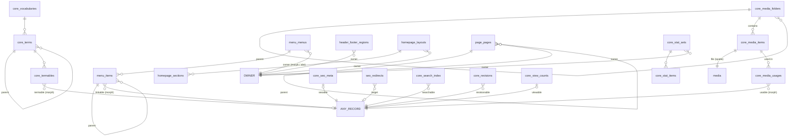

# Database Design
## DB-02 — Site-building Core Tables

| বিষয় | তথ্য |
|---|---|
| Document | Database Design DB-02 |
| Version | 0.2 — 2026-10-11: free menu (`menu_menus.location` null), page-এর নিজের sidebar menu (`page_pages.sidebar_menu_id`), module landing page (§5.1, §8.1); v0.3 (2026-10-26, Phase 4.7b): `page_pages.quick_links` — sidebar-এর নিচে "Quick Links" (DIU-র /admission); v0.4 (2026-10-26, Phase 4.7g): `seo_search_terms` — website-এ কী খোঁজা হয় ও কী পাওয়া যায় না (§9.4) |
| Date | 2026-10-08 |
| Status | ✔ Confirmed |
| Based on | [DB-01](01-DB-Core-Kernel.md) (conventions), SRS Part 1, SAD Part A / B |
| Covers | C-06 Theme, C-07 Media, C-08 Menu, C-09 Header & Footer, C-10 Homepage, C-11 Pages, C-12 SEO & Redirect, C-14 API, C-16 Taxonomy, C-17 Search, C-18 Notification, C-19 Backup, C-20 Statistics, এবং kernel shared-service table (Revision, View count) |

> Convention, data type ও শ্রেণী (B / C / P / S / L) [DB-01 Section 1](01-DB-Core-Kernel.md#1-conventions-সব-db-document-এ-প্রযোজ্য) অনুযায়ী।

---

## 1. এই Document-এ যোগ হওয়া Convention

### 1.1 Table কোথায় থাকবে: `core_` নাকি module prefix

| নিয়ম | Prefix | কারণ |
|---|---|---|
| যে table কোনো **kernel trait** (`HasSeo`, `HasTaxonomy`, `HasMediaUsage`, `IsSearchable`, `HasRevisions`, `HasViewCount`) বা **kernel engine** (Statistics) সরাসরি ব্যবহার করে | `core_` | Kernel কোনো module চেনে না (SAD D-1); তাই trait-এর table kernel-এর হতে হবে |
| যে table শুধু একটি core module-এর নিজস্ব feature (UI, admin) | Module slug prefix (`menu_`, `homepage_`, `page_`, `seo_` ...) | সাধারণ module নিয়ম (SAD Part A Section 9) |

Kernel engine যখন module-এর table পড়ে (যেমন Fallback Resolver → Menu), তখন module একটি **store contract** register করে; kernel table নাম জানে না (SAD Part B 6.2)।

### 1.2 Main Site owner = `('site', 0)`

Owner (P-04 থেকে P-08) "Main Site" হলে `owner_type = 'site'`, `owner_id = 0` — `NULL` নয়। কারণ MySQL-এ `NULL` মান unique index-এ আলাদা গণ্য হয়, ফলে main site-এর জন্য একই location-এ দুটি menu তৈরি হয়ে যেতে পারত। এটি `core_relations`-এর Main Site pseudo-target (ADR-15)-এর সাথেও সামঞ্জস্যপূর্ণ।

### 1.3 Soft delete থাকা table-এ Unique — `active_key`

MySQL-এ `UNIQUE(x, deleted_at)` **কাজ করে না**: সব active row-এর `deleted_at = NULL`, এবং `NULL`-গুলো পরস্পর আলাদা গণ্য হয়, তাই duplicate active row আটকায় না।

সমাধান — generated column:

```sql
active_key TINYINT AS (IF(deleted_at IS NULL, 1, NULL)) STORED,
UNIQUE KEY uq_menu_location (owner_type, owner_id, location, active_key)
```

Active row-এ `active_key = 1` → unique কার্যকর; deleted row-এ `NULL` → উপেক্ষিত, তাই একই মানের নতুন row তৈরি করা যায়। `platformColumns()` macro-তে `active_key` যোগ হবে। (SAD Part A IX-8 এই অনুযায়ী সংশোধিত।)

### 1.4 লম্বা String-এ Unique

URL / path (`VARCHAR(2048)`) সরাসরি unique index করা যায় না (index length সীমা)। তাই `path_hash CHAR(64)` (SHA-256) column-এ unique, এবং মূল path আলাদা column-এ।

---

## 2. ERD (এই document-এর table)



---

## 3. C-07 Media Library (kernel-backed)

**Design:** প্রতিটি upload করা file = একটি `core_media_items` row (metadata, folder, scope) + spatie-র একটি `media` row (file, conversion), যার model = সেই `core_media_items`। Module-এর record file সরাসরি রাখে না; `core_media_usages` দিয়ে media item reference করে (BR-MED-01, BRL-GAL-01)।

### 3.1 `core_media_folders` — B

| Column | Type | Key / N | বর্ণনা |
|---|---|---|---|
| id | BIGINT UNSIGNED | PK | |
| parent_id | BIGINT UNSIGNED | N, FK self (restrict), IX | Nested folder (FR-MEDIA-08) |
| name | VARCHAR(191) | | |
| scope_type, scope_id | VARCHAR(100), BIGINT UNSIGNED | IX | কার folder; `site, 0` = সবার (P-22) |
| ⚙ | | | |

UQ: `(parent_id, scope_type, scope_id, name, active_key)`।

### 3.2 `core_media_items` — B

| Column | Type | Key / N | Default | বর্ণনা |
|---|---|---|---|---|
| id | BIGINT UNSIGNED | PK | | |
| folder_id | BIGINT UNSIGNED | N, FK core_media_folders (set null), IX | | |
| title | JSON | N, T | | FR-MEDIA-06 |
| alt_text | JSON | N, T | | FR-GEN-61 |
| caption | JSON | N, T | | |
| description | JSON | N, T | | |
| kind | VARCHAR(20) | IX | | `image` / `document` / `video` / `audio` / `archive` / `other` (filter, FR-MEDIA-05) |
| mime_type | VARCHAR(127) | | | spatie থেকে denormalized (filter-এর জন্য) |
| size_bytes | BIGINT UNSIGNED | | | |
| width, height | INT UNSIGNED | N | | Image হলে |
| file_hash | CHAR(64) | IX | | SHA-256; duplicate সতর্কতা (FR-MEDIA-16) |
| scope_type, scope_id | VARCHAR(100), BIGINT UNSIGNED | IX (scope_type, scope_id) | `site`, 0 | Upload-কারীর scope (BRL-MEDIA-01, P-22) |
| is_shared | TINYINT(1) | | 0 | FR-MEDIA-14 / BR-MED-15 |
| is_private | TINYINT(1) | | 0 | Signed URL (BRL-MEDIA-02) |
| usage_count | INT UNSIGNED | IX | 0 | Denormalized; "Unused media" filter (FR-MEDIA-15) |
| ⚙ | | | | `created_by` = uploader; `created_at` = upload মাস / বছর filter |

IX: `(kind, created_at)`, `(created_by)`।

### 3.3 `media` — S (spatie/laravel-medialibrary, F-07)

Package-এর default table। `model_type = 'core.media-item'`, `model_id = core_media_items.id`, `collection_name = 'file'`। Conversion (thumbnail 150, medium 768, large 1600, WebP) `generated_conversions`-এ। পরিবর্তন নেই।

### 3.4 `core_media_usages` — P (P-13)

| Column | Type | Key / N | বর্ণনা |
|---|---|---|---|
| id | BIGINT UNSIGNED | PK | |
| media_item_id | BIGINT UNSIGNED | FK core_media_items (cascade), IX | Force delete-এ usage মুছে যায়; soft delete-এ থাকে (FR-MEDIA-10) |
| usable_type | VARCHAR(100) | | `news.post` |
| usable_id | BIGINT UNSIGNED | | |
| field | VARCHAR(60) | | `featured_image`, `gallery`, `attachments`, `logo`, `avatar` |
| sort_order | INT UNSIGNED | | Gallery / attachment ক্রম |
| meta | JSON | N | Field-ভিত্তিক অতিরিক্ত (যেমন attachment-এর আলাদা title — FR-NOT-01) |
| created_at, updated_at | TIMESTAMP | | |

UQ: `(usable_type, usable_id, field, media_item_id)`; IX: `(usable_type, usable_id, field, sort_order)`।
`usage_count` insert / delete-এ update হয় (একই transaction)।

---

## 4. C-16 Taxonomy (kernel-backed)

### 4.1 `core_vocabularies` — C

| Column | Type | Key / N | Default | বর্ণনা |
|---|---|---|---|---|
| id | BIGINT UNSIGNED | PK | | |
| key | VARCHAR(100) | UQ | | `news.category`, `program.level`, `shared.tags` |
| module_slug | VARCHAR(100) | N, IX | | Null = shared |
| name | JSON | T | | |
| is_hierarchical | TINYINT(1) | | 0 | |
| allows_multiple | TINYINT(1) | | 1 | |
| is_ordered | TINYINT(1) | | 0 | Designation-এর মতো ক্রম অর্থবহ (FR-FM-06) |
| created_at, updated_at | TIMESTAMP | | | |

### 4.2 `core_terms` — B

| Column | Type | Key / N | বর্ণনা |
|---|---|---|---|
| id | BIGINT UNSIGNED | PK | |
| vocabulary_id | BIGINT UNSIGNED | FK core_vocabularies (cascade), IX | |
| parent_id | BIGINT UNSIGNED | N, FK self (restrict), IX | |
| name | JSON | T | |
| description | JSON | N, T | Category-র উপরের / নিচের বিবরণ (FR-FAQ-01, FR-CSR-01) `{"top": ..., "bottom": ...}` রূপে |
| color | VARCHAR(20) | N | |
| icon | VARCHAR(100) | N | |
| sort_order | INT UNSIGNED | | |
| ⚙ | | | |

Slug: `core_slugs` (archive page, FR-TAX-05)। ছবি: Media usage।
IX: `(vocabulary_id, parent_id, sort_order)`।

### 4.3 `core_termables` — P (P-12)

| Column | Type | Key / N | বর্ণনা |
|---|---|---|---|
| term_id | BIGINT UNSIGNED | FK core_terms (cascade) | |
| termable_type | VARCHAR(100) | | |
| termable_id | BIGINT UNSIGNED | | |
| sort_order | SMALLINT UNSIGNED | | Primary category আগে |
| created_at | TIMESTAMP | | |

PK: `(term_id, termable_type, termable_id)`; IX: `(termable_type, termable_id)`।

---

## 5. C-08 Menu Management

### 5.1 `menu_menus` — B (P-04)

| Column | Type | Key / N | বর্ণনা |
|---|---|---|---|
| id | BIGINT UNSIGNED | PK | |
| name | VARCHAR(191) | | Admin-এর জন্য |
| owner_type, owner_id | VARCHAR(100), BIGINT UNSIGNED | | `site, 0` অথবা microsite entity |
| location | VARCHAR(50) | N | `primary`, `topbar`, `footer-1` ... `quick-links`, `quick-links-icon`, `sidebar`; *(v0.2)* null = **free menu** — কোনো location-এ নয়, page নিজের sidebar menu হিসেবে বাছে (§8.1) |
| style | VARCHAR(20) | | `dropdown` (default) / `multilevel` / `mega` — website-এ menu কীভাবে খুলবে *(v1.1)* |
| ⚙ | | | |

UQ: `(owner_type, owner_id, location, active_key)` (BRL-MENU-03) — location null হলে বাধা নেই, তাই একটি owner-এর অনেক free menu থাকতে পারে (যেমন Admission, DLRC, Medical-এর বাম পাশের menu) *(v0.2)*।

### 5.2 `menu_items` — B (P-11)

| Column | Type | Key / N | Default | বর্ণনা |
|---|---|---|---|---|
| id | BIGINT UNSIGNED | PK | | |
| menu_id | BIGINT UNSIGNED | FK menu_menus (cascade), IX | | |
| parent_id | BIGINT UNSIGNED | N, FK self (cascade) | | Nested (FR-MENU-02) |
| type | VARCHAR(20) | | | `record` / `module_page` / `taxonomy` / `url` / `file` / `heading` (FR-MENU-03) |
| linkable_type, linkable_id | VARCHAR(100), BIGINT UNSIGNED | N, IX | | `record`, `taxonomy`, `file` হলে (P-11) |
| route_key | VARCHAR(150) | N | | `module_page` হলে (যেমন `news.index`) |
| url | TEXT | N | | `url` হলে |
| title | JSON | T | | FR-MENU-05; null হলে linked record-এর title |
| icon | VARCHAR(100) | N | | Quick links (icon) |
| open_in_new_tab | TINYINT(1) | | 0 | |
| css_class | VARCHAR(100) | N | | Mega menu / style |
| options | JSON | N | | শুধু উপরের item *(v1.1)*: `display` (`mega` / `dropdown`; না থাকলে menu-র style), `columns` (২–৬), `image` (Media id, usage `mega_image`), `description` ও `cta_label` (ভাষা অনুযায়ী), `cta_url` |
| sort_order | INT UNSIGNED | | 0 | |
| ⚙ | | | | |

IX: `(menu_id, parent_id, sort_order)`।
Nested ৪ স্তর পর্যন্ত (multi-level dropdown); mega panel-এ দ্বিতীয় স্তর = কলামের শিরোনাম, তৃতীয় স্তর = link *(v1.1)*।
Visibility (FR-MENU-10/11) render-এর সময় linked record-এর `frontendVisible()` ও module status দিয়ে; DB-তে আলাদা flag নয়।

---

## 6. C-09 Header & Footer — `header_footer_regions` — C (P-05)

| Column | Type | Key / N | বর্ণনা |
|---|---|---|---|
| id | BIGINT UNSIGNED | PK | |
| owner_type, owner_id | VARCHAR(100), BIGINT UNSIGNED | | `site, 0` বা entity |
| region | VARCHAR(20) | | `topbar` / `header` / `footer` |
| variant | VARCHAR(50) | | Theme-এর variant |
| config | JSON | | Topbar toggle, footer column ও block (FR-HF-02/03) |
| copyright | JSON | N, T | `{year}` placeholder সহ |
| is_active | TINYINT(1) | | |
| updated_by | BIGINT UNSIGNED | N, FK users | |
| created_at, updated_at | TIMESTAMP | | |

UQ: `(owner_type, owner_id, region)`।

---

## 7. C-10 Homepage Builder

### 7.1 `homepage_layouts` — C (P-06)

| Column | Type | Key / N | বর্ণনা |
|---|---|---|---|
| id | BIGINT UNSIGNED | PK | |
| owner_type, owner_id | VARCHAR(100), BIGINT UNSIGNED | | |
| is_active | TINYINT(1) | | Inactive → theme default (FR-HOME-08) |
| updated_by | BIGINT UNSIGNED | N, FK users | |
| created_at, updated_at | TIMESTAMP | | |

UQ: `(owner_type, owner_id)`।

**ধরনের সাধারণ homepage (2026-10-17, FR-HOME-13):** `owner_id = 0` আর `owner_type` একটি microsite ধরন (যেমন `department.department`) = সেই ধরনের সব microsite-এর সাধারণ homepage ("All Departments")। Microsite-এর নিজের সক্রিয় layout না থাকলে এটি ব্যবহার হয়; section-এর data তবুও সেই microsite-এর (cache key-তে owner আছে)। নতুন column বা table লাগেনি।

### 7.2 `homepage_sections` — B

| Column | Type | Key / N | বর্ণনা |
|---|---|---|---|
| id | BIGINT UNSIGNED | PK | |
| layout_id | BIGINT UNSIGNED | FK homepage_layouts (cascade), IX | |
| section_type | VARCHAR(100) | IX | Registry key: `core.hero`, `core.statistics`, `news.latest`, `events.upcoming` ... |
| heading | JSON | N, T | |
| subheading | JSON | N, T | |
| settings | JSON | | Source mode (FR-HOME-11), item সংখ্যা, filter, layout variant, background, manual id তালিকা, stat set id; theme section-এর field-এর মান `content`-এর নিচে (`section_type` = `theme.{name}`, FR-HOME-14) |
| sort_order | INT UNSIGNED | | |
| visible_from, visible_until | TIMESTAMP | N | FR-HOME-06 |
| ⚙ | | | |

IX: `(layout_id, is_active, sort_order)`।
Source module inactive হলে section লুকানো হয় render-এ (section_type-এর module prefix দেখে; FR-HOME-09)।

---

## 8. C-11 Pages

### 8.1 `page_pages` — B (P-08)

| Column | Type | Key / N | Default | বর্ণনা |
|---|---|---|---|---|
| id | BIGINT UNSIGNED | PK | | |
| owner_type, owner_id | VARCHAR(100), BIGINT UNSIGNED | | `site, 0` | FR-PAGE-05 |
| parent_id | BIGINT UNSIGNED | N, FK self (restrict), IX | | FR-PAGE-03 |
| title | JSON | T | | |
| excerpt | JSON | N, T | | |
| content | JSON | N, T | | ভাষা অনুযায়ী block array (FR-PAGE-01/02) |
| template | VARCHAR(50) | | `default` | FR-PAGE-04 |
| sidebar_menu_id | BIGINT UNSIGNED | N, IX (অন্য module-এর table — FK নয়, SAD Part A §6.6) | | *(v0.2)* এই page-এর বাম পাশের menu (একই owner-এর menu)। Null = parent page-এরটি, তাও না থাকলে owner-এর `sidebar` location-এর menu |
| quick_links | JSON | N | | *(v0.3)* sidebar menu-র নিচে "Quick Links" — `[{label: {en, bn}, url}]` (LinkListField, `link_list()`); শুধু sidebar template-এ (`with-sidebar` বাম, `right-sidebar` ডান) |
| published_at, expires_at | TIMESTAMP | N | | |
| sort_order | INT UNSIGNED | | 0 | |
| ⚙ | | | | |

IX: `(owner_type, owner_id, parent_id, sort_order)`; IX-5: `(is_active, deleted_at, published_at)`।
Slug → `core_slugs` (URL-এ parent path যোগ হয় render-এ)। Attachment → Media usage (`field = attachments`)। SEO → `core_seo_meta`। Revision → `core_revisions`।

*(v0.2)* **Module landing page:** main site-এর page সাধারণত reserved path নিতে পারে না (UrlRules), কিন্তু যে module নিজের landing হিসেবে page চায় (`admission`, আগে থেকে `contact`), সেই path page নিতে পারে; module-এর নিজের page-গুলো (`/admission/result`, `/admission/circulars/…`) তার child page-এর slug হতে পারবে না।

---

## 9. C-12 SEO & Redirect

### 9.1 `core_seo_meta` — C (P-14)

| Column | Type | Key / N | বর্ণনা |
|---|---|---|---|
| id | BIGINT UNSIGNED | PK | |
| seoable_type, seoable_id | VARCHAR(100), BIGINT UNSIGNED | UQ (দুটি মিলে) | |
| meta_title | JSON | N, T | Null → auto (FR-GEN-71) |
| meta_description | JSON | N, T | |
| canonical_url | VARCHAR(2048) | N | |
| noindex | TINYINT(1) | | |
| schema_overrides | JSON | N | JSON-LD override |
| created_at, updated_at | TIMESTAMP | | |

OG image → Media usage (`usable = core.seo-meta`, `field = og_image`)।

### 9.2 `seo_redirects` — B (P-15)

| Column | Type | Key / N | Default | বর্ণনা |
|---|---|---|---|---|
| id | BIGINT UNSIGNED | PK | | |
| source_path | VARCHAR(2048) | | | `/old-url` (query ছাড়া, normalized) |
| source_hash | CHAR(64) | | | SHA-256 (Section 1.4) |
| destination_url | VARCHAR(2048) | N | | External / manual |
| target_type, target_id | VARCHAR(100), BIGINT UNSIGNED | N, IX | | Internal record (P-15); URL render-এ তৈরি, তাই slug বদলালেও সঠিক |
| status_code | SMALLINT UNSIGNED | | 301 | 301 / 302 |
| hits | INT UNSIGNED | | 0 | |
| last_hit_at | TIMESTAMP | N | | |
| source | VARCHAR(20) | | `manual` | `manual` / `import` / `404` |
| ⚙ | | | | |

UQ: `(source_hash, active_key)`।
Loop প্রতিরোধ (FR-SEO-09) application-এ save-এর সময়।

### 9.3 `seo_not_found_logs` — L

| Column | Type | Key / N | বর্ণনা |
|---|---|---|---|
| id | BIGINT UNSIGNED | PK | |
| path | VARCHAR(2048) | | |
| path_hash | CHAR(64) | UQ | |
| hits | INT UNSIGNED | | |
| last_referrer | VARCHAR(2048) | N | |
| first_seen_at, last_seen_at | TIMESTAMP | IX (last_seen_at) | |
| is_resolved | TINYINT(1) | | Redirect তৈরি হলে |

> L শ্রেণী হলেও hit-এর সময় `hits` update হয় (aggregate log)। পুরনো resolved row ৯০ দিন পর মুছে যায়।

### 9.4 `seo_search_terms` — L *(v0.4)*

| Column | Type | Key / N | বর্ণনা |
|---|---|---|---|
| id | BIGINT UNSIGNED | PK | |
| term | VARCHAR(191) | | ছোট হাতের, ফাঁকা কমানো খোঁজা |
| term_hash | CHAR(64) | UQ | SHA-256 of term |
| hits | INT UNSIGNED | | কতবার খোঁজা হয়েছে |
| last_results | INT UNSIGNED | | শেষবার কত ফল (০ = পাওয়া যায়নি) |
| first_searched_at, last_searched_at | TIMESTAMP | IX (last_searched_at) | |

> Search page-এর প্রথম পাতায় খোঁজা হলে (kernel event `SearchPerformed`) লেখা হয়, type করার সময় নয়। ১৮০ দিন খোঁজা না হলে মুছে যায়। "Popular searches" = Settings › Search-এ দেওয়াগুলো, নইলে গত ৯০ দিনে সবচেয়ে বেশি খোঁজা যেগুলোয় ফল ছিল।

---

## 10. C-17 Global Search — `core_search_index` — S (P-16)

| Column | Type | Key / N | বর্ণনা |
|---|---|---|---|
| id | BIGINT UNSIGNED | PK | |
| searchable_type, searchable_id | VARCHAR(100), BIGINT UNSIGNED | | |
| locale | VARCHAR(10) | | প্রতিটি ভাষার জন্য আলাদা row (ADR-07) |
| module_slug | VARCHAR(100) | IX | Group ও filter (FR-SRCH-02) |
| owner_key | VARCHAR(150) | N, IX | Record-এর মালিক entity (`department.department:12`); "শুধু এই Department-এ" (FR-SRCH-06)। Main site = NULL *(v1.2, Phase 2.10)* |
| title | VARCHAR(500) | | |
| body | MEDIUMTEXT | | HTML বাদ দেওয়া plain text |
| url | VARCHAR(2048) | | |
| weight | TINYINT UNSIGNED | | Module-ভিত্তিক ওজন |
| published_at | TIMESTAMP | N | |
| updated_at | TIMESTAMP | | |

UQ: `(searchable_type, searchable_id, locale)`; FULLTEXT: `(title, body)`; IX: `(locale, module_slug)`।

* শুধু `frontendVisible()` record index হয় (FR-SRCH-03); unpublish / delete / module deactivate → row মুছে যায়।
* **বাংলা:** InnoDB FULLTEXT space দিয়ে শব্দ ভাগ করে, তাই বাংলা শব্দ কাজ করে; তবে `innodb_ft_min_token_size` (default 3) ছোট বাংলা শব্দ বাদ দিতে পারে — server config-এ 2 করা হবে (Deployment Plan)। Search quality অপর্যাপ্ত হলে Meilisearch-এ যাওয়ার পথ খোলা (Scout driver পরিবর্তন)।

---

## 11. C-20 Statistics (kernel engine)

### 11.1 `core_stat_sets` — B (P-07)

| Column | Type | Key / N | Default | বর্ণনা |
|---|---|---|---|---|
| id | BIGINT UNSIGNED | PK | | |
| owner_type, owner_id | VARCHAR(100), BIGINT UNSIGNED | | | `site, 0` বা entity |
| key | VARCHAR(50) | | `default` | একাধিক set (FR-STAT-01) |
| name | JSON | T | | |
| ⚙ | | | | |

UQ: `(owner_type, owner_id, key, active_key)`।

### 11.2 `core_stat_items` — B

| Column | Type | Key / N | Default | বর্ণনা |
|---|---|---|---|---|
| id | BIGINT UNSIGNED | PK | | |
| stat_set_id | BIGINT UNSIGNED | FK core_stat_sets (cascade), IX | | |
| label | JSON | T | | |
| source | VARCHAR(10) | | `manual` | `manual` / `metric` |
| metric_key | VARCHAR(100) | N, IX | | `program.count` |
| metric_params | JSON | N | | যেমন `{"level": "graduate"}` |
| manual_value | BIGINT | N | | |
| override_value | BIGINT | N | | FR-STAT-06 |
| rounding | VARCHAR(20) | N | | `none` / `hundred` / `thousand` / `plus` |
| prefix, suffix | VARCHAR(20) | N | | |
| icon | VARCHAR(100) | N | | |
| as_of | DATE | N | | |
| sort_order | INT UNSIGNED | | 0 | |
| ⚙ | | | | |

Metric value DB-তে রাখা হয় না; cache-এ (SAD Part B 7.4)।

---

## 12. Kernel Shared-service Table

### 12.1 `core_revisions` — L (P-18)

| Column | Type | Key / N | বর্ণনা |
|---|---|---|---|
| id | BIGINT UNSIGNED | PK | |
| revisionable_type, revisionable_id | VARCHAR(100), BIGINT UNSIGNED | IX (দুটি + version) | |
| version | INT UNSIGNED | | |
| data | JSON | | Translatable field সহ snapshot |
| created_by | BIGINT UNSIGNED | N, FK users | |
| created_at | TIMESTAMP | | |

প্রতিটি record-এর শেষ ১০টি রাখা হয় (FR-PAGE-07); পুরনোগুলো save-এর সময় মুছে যায়।

### 12.2 ~~`core_approvals`~~ — বাদ

BRD Q-27: Approval workflow নেই, তাই এই table ও P-19 বাদ।

### 12.3 `core_view_counts` — S (P-17)

| Column | Type | Key / N | বর্ণনা |
|---|---|---|---|
| viewable_type, viewable_id | VARCHAR(100), BIGINT UNSIGNED | PK (দুটি মিলে) | |
| total | BIGINT UNSIGNED | IX (viewable_type, total) | "Most viewed" sort |
| last_viewed_at | TIMESTAMP | N | |

View increment Redis-এ জমা হয়ে প্রতি ৫ মিনিটে batch-এ লেখা হয় (প্রতি page view-এ DB write নয়); bot user-agent বাদ (FR-CNT-C08)।

*(2026-10-16, build-এর সময়)* তৈরি হয়েছে M-11 Calendar-এর সাথে: `Platform\Views\ViewCounter` app-এর cache store-এ জমায় (production-এ Redis, dev-এ database), `uwms:views:flush` প্রতি ৫ মিনিটে; model-এ `HasViewCount` (`countView()`, `withViewTotal()`, `mostViewed()`); legacy `total_views` migration-এ `seed()` দিয়ে।

---

## 13. C-06 Theme — `theme_themes` — S

| Column | Type | Key / N | বর্ণনা |
|---|---|---|---|
| id | BIGINT UNSIGNED | PK | |
| slug | VARCHAR(100) | UQ | |
| name | VARCHAR(100) | | |
| version | VARCHAR(30) | | |
| source_path | VARCHAR(255) | | `themes/{slug}` বা runtime shared folder (ADR-12) |
| manifest | JSON | | `theme.json` snapshot |
| is_active | TINYINT(1) | IX | একটিই active (application) |
| is_bundled | TINYINT(1) | | Default theme uninstall নিষেধ (BRL-THEME-01) |
| installed_by | BIGINT UNSIGNED | N, FK users | |
| created_at, updated_at | TIMESTAMP | | |

Design token (color, font ...) ও module layout selection → `core_settings` (group `theme.{slug}` ও `layouts`)। Theme পরিবর্তনের ইতিহাস → activity log।

---

## 14. C-18 Notification

### 14.1 `notifications` — S (Laravel, F-05)

Laravel default (`notifiable` morph, `data` JSON, `read_at`)। ৯০ দিনের পুরনো পড়া notification মুছে যায় (FR-NOTI-08)।

### 14.2 `notification_preferences` — C

| Column | Type | Key / N | বর্ণনা |
|---|---|---|---|
| id | BIGINT UNSIGNED | PK | |
| user_id | BIGINT UNSIGNED | FK users (cascade) | |
| type | VARCHAR(150) | | Registry key (`inquiry.received`) |
| channels | JSON | | `["database", "mail"]` |
| created_at, updated_at | TIMESTAMP | | |

UQ: `(user_id, type)`। Row না থাকলে type-এর default channel।

### 14.3 `notification_templates` — C

| Column | Type | Key / N | বর্ণনা |
|---|---|---|---|
| id | BIGINT UNSIGNED | PK | |
| key | VARCHAR(150) | UQ | |
| subject | JSON | T | |
| body | JSON | T | Placeholder সহ |
| is_active | TINYINT(1) | | |
| updated_by | BIGINT UNSIGNED | N, FK users | |
| created_at, updated_at | TIMESTAMP | | |

### 14.4 Content Update Reminder (BRD 7.10, FR-NOTI-09 থেকে 16 — confirmed)

#### `notification_reminder_rules` — B

| Column | Type | Key / N | Default | বর্ণনা |
|---|---|---|---|---|
| id | BIGINT UNSIGNED | PK | | |
| module_slug | VARCHAR(100) | IX | | Freshness source module (FR-NOTI-10) |
| entity_type | VARCHAR(100) | | `department.department` | কোন microsite entity-র জন্য |
| max_days_without_update | SMALLINT UNSIGNED | | 90 | বর্তমান `duration` |
| remind_every_days | SMALLINT UNSIGNED | | 7 | বর্তমান `interval_duration` |
| is_mandatory | TINYINT(1) | | 1 | BR-REM-02 |
| check_mode | VARCHAR(20) | | `latest` | `latest` / `each_record` (বর্তমান `is_individual_check`) |
| empty_message | JSON | T | | Entity user — content নেই |
| stale_message | JSON | T | | Entity user — content পুরনো |
| admin_empty_message | JSON | N, T | | |
| admin_stale_message | JSON | N, T | | |
| ⚙ | | | | |

UQ: `(module_slug, entity_type, active_key)`।

#### `notification_reminder_states` — S

| Column | Type | Key / N | Default | বর্ণনা |
|---|---|---|---|---|
| id | BIGINT UNSIGNED | PK | | |
| rule_id | BIGINT UNSIGNED | FK notification_reminder_rules (cascade) | | |
| entity_type, entity_id | VARCHAR(100), BIGINT UNSIGNED | | | |
| status | VARCHAR(10) | IX | `ok` | `ok` / `empty` / `stale` |
| last_content_at | TIMESTAMP | N | | Entity-র সর্বশেষ update |
| stale_records | JSON | N | | Each-record mode-এ পুরনো record-এর id তালিকা |
| last_reminded_at | TIMESTAMP | N | | |
| reminder_count | INT UNSIGNED | | 0 | OK হলে 0-তে ফেরে |
| checked_at | TIMESTAMP | | | |

UQ: `(rule_id, entity_type, entity_id)`; IX: `(entity_type, entity_id)` (dashboard widget, FR-NOTI-16)।

---

## 15. C-19 Backup — `backup_runs` — L

| Column | Type | Key / N | বর্ণনা |
|---|---|---|---|
| id | BIGINT UNSIGNED | PK | |
| type | VARCHAR(20) | IX | `database` / `full` / `pre_module_install` |
| status | VARCHAR(20) | IX | `running` / `success` / `failed` |
| disk | VARCHAR(50) | | |
| path | VARCHAR(500) | N | |
| size_bytes | BIGINT UNSIGNED | N | |
| error | TEXT | N | |
| reason | VARCHAR(255) | N | কেন: "install news 1.2.0", "theme campus 1.1.0" … *(v1.2, Phase 2.12)* |
| triggered_by | BIGINT UNSIGNED | N, FK users | Null = scheduler |
| started_at, finished_at | TIMESTAMP | N | |

---

## 16. C-14 API — `personal_access_tokens` — S (Sanctum, F-06)

Sanctum default (`tokenable` morph, `abilities`, `last_used_at`, `expires_at`) — FR-API-05 পূরণ করে। Rate limit ও CORS → `core_settings` (group `api`)। আলাদা API request log table নেই (প্রয়োজনে Could)।

---

## 17. Table সারসংক্ষেপ (DB-02)

| # | Table | শ্রেণী | Module | Polymorphic |
|---|---|---|---|---|
| 1 | core_media_folders | B | C-07 | P-22 (scope) |
| 2 | core_media_items | B | C-07 | P-22 (scope) |
| 3 | media | S | C-07 (spatie) | F-07 |
| 4 | core_media_usages | P | C-07 | P-13 |
| 5 | core_vocabularies | C | C-16 | — |
| 6 | core_terms | B | C-16 | — |
| 7 | core_termables | P | C-16 | P-12 |
| 8 | menu_menus | B | C-08 | P-04 |
| 9 | menu_items | B | C-08 | P-11 |
| 10 | header_footer_regions | C | C-09 | P-05 |
| 11 | homepage_layouts | C | C-10 | P-06 |
| 12 | homepage_sections | B | C-10 | — |
| 13 | page_pages | B | C-11 | P-08 |
| 14 | core_seo_meta | C | C-12 | P-14 |
| 15 | seo_redirects | B | C-12 | P-15 |
| 16 | seo_not_found_logs | L | C-12 | — |
| 16a | seo_search_terms *(v0.4)* | L | C-12 | — |
| 17 | core_search_index | S | C-17 | P-16 |
| 18 | core_stat_sets | B | C-20 | P-07 |
| 19 | core_stat_items | B | C-20 | — |
| 20 | core_revisions | L | Kernel | P-18 |
| 21 | ~~core_approvals~~ — বাদ (BRD Q-27) | — | — | — |
| 22 | core_view_counts | S | Kernel | P-17 |
| 23 | theme_themes | S | C-06 | — |
| 24 | notifications | S | C-18 (Laravel) | F-05 |
| 25 | notification_preferences | C | C-18 | — |
| 26 | notification_templates | C | C-18 | — |
| 27 | notification_reminder_rules, notification_reminder_states | B, S | C-18 (Reminder) | — |
| 28 | backup_runs | L | C-19 | — |
| 29 | personal_access_tokens | S | C-14 (Sanctum) | F-06 |

**DB-01 + DB-02 মিলিয়ে core-এর মোট table:** DB-01-এর ১৭টি সারি (Laravel ও spatie system table সহ) + DB-02-এর ২৯টি সারি। Polymorphic P-01 থেকে P-22-এর মধ্যে P-20 (Inquiry) ছাড়া সবগুলো এই দুই document-এ।

---

## 18. `project_diu` থেকে Migration Mapping (DB-02 অংশ)

| বর্তমান | নতুন | রূপান্তর |
|---|---|---|
| বিভিন্ন table-এর file / image column (`photo`, `image`, `file_name`, `thumb`, `logo`, `notice_files.file_name` ...) | `core_media_items` + `media` + `core_media_usages` | প্রতিটি file Media Library-তে import (একই file একবার — hash দিয়ে), তারপর usage row। মোট file সংখ্যা ও আকার migration-এর আগে গণনা করতে হবে (`notice_files` একাই ৩,৫০০) |
| `faculty_menus` (৫০), `department_menus` (৯১৬), `program_menus` (৩৪), `lab_menus` (১৫), `lab_app_menus` (৮), `side_menus` (১৩) + `side_menu_categories` | `menu_menus` (owner অনুযায়ী) + `menu_items` | `link_type`: `article_link` → `record` (Page), `module_link` → `module_page`, `external_link` → `url`, `file` → `file` (Media); `parent_id` ও `serial` → `parent_id` ও `sort_order`; `lab_app_menus` → location `quick-links-icon`; *(v0.2)* `side_menu_categories` (DLRC, Medical) → প্রতিটি একটি free menu, তার page-গুলোর `sidebar_menu_id` |
| `faculty_articles`, `department_articles`, `program_articles`, `lab_articles`, `articles`, `registrar_offices`, `proctor_offices` | `page_pages` (owner অনুযায়ী) | Menu-র `article_link` এই নতুন page-এ remap (ID mapping table) |
| `seo` (২৬) | `core_seo_meta` | `model_type` পুরনো class → নতুন morph alias; `meta_data` JSON ভেঙে field-এ |
| পুরনো website-এর URL | `seo_redirects` (`source = import`) | পুরনো URL তালিকা (sitemap / analytics থেকে) → নতুন URL; CSV import (FR-SEO-05) |
| বিভিন্ন `*_categories` table | `core_vocabularies` + `core_terms` | Module অনুযায়ী (DB-03 থেকে DB-06-এ বিস্তারিত) |
| `notification_settings` (১২টি rule, ৯টি active) | `notification_reminder_rules` | `duration` → `max_days_without_update`, `interval_duration` → `remind_every_days`, `is_individual_check` → `check_mode`, `notification_null_message` / `notification_update_message` (ও `_admin`) → চারটি বার্তা (`en`); `entity_type = department.department`। `model_name` → module: DepartmentArticle → `page` (owner Department), Notice → `notice`, ProgramType → `program`, Documentary ও Photo → `gallery`, Slider → `slider`, Visitor → `international`, Faq → `faq`, NewsTicker → `announcement-widgets`, LabFacility → `lab`, Event → `events`, Alumni → `alumni` |
| `notification_remembers` (০ row) | — | Migrate করার কিছু নেই; নতুন system প্রথম দিনের হিসাব থেকে শুরু করবে |

---

## 19. অন্য Document-এ সংশোধন

| Document | সংশোধন |
|---|---|
| SAD Part A, Section 6.6, IX-8 | `UNIQUE(..., deleted_at)` → `UNIQUE(..., active_key)` (Section 1.3) |
| SAD Part A, Section 6.5 | `platformColumns()`-এ `active_key` generated column |
| SRS Part 0, Appendix 6 | P-22 (Media scope) যোগ; Main Site owner `('site', 0)` |
