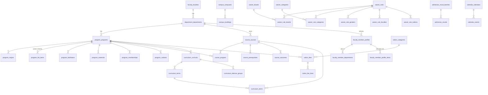

# Database Design
## DB-03 — Academic Modules (M-01 থেকে M-11)

| বিষয় | তথ্য |
|---|---|
| Document | Database Design DB-03 |
| Version | 1.5 — v1.1: §11 legacy calculator-এর সাথে মিল; v1.2: Waiver Calculator নিজের module `waiver`; v1.3: tuition নিজের module `tuition` (আলাদা team data দেয়); v1.4: Scholarship নিজের module `scholarship`, parent / child ও category vocabulary (§11.3); v1.5: Admission (§10) — `published_at` নয় `is_active`, session লেখা, result label, subscriber topic, website গঠন |
| Date | 2026-10-11 (v1.0 confirmed 2026-10-08) |
| Status | ✔ Confirmed — v1.3 approved 2026-10-10 (Tuition, Waiver আলাদা module); v1.1 approved 2026-10-10: entry করা rule ও data অক্ষত থাকবে; logic বদলানো যাবে যদি ফলাফল হুবহু একই থাকে (golden master দিয়ে প্রমাণ) |
| Based on | [DB-01](01-DB-Core-Kernel.md) (conventions), [DB-02](02-DB-Core-SiteBuilding.md), [SRS Part 2](../02-SRS/02-SRS-Academic.md), `project_diu` |

> Convention, শ্রেণী (B / C / P / S / L), ⚙ (`platformColumns()`), `active_key` ও Main Site `('site', 0)` — DB-01 Section 1 ও DB-02 Section 1 অনুযায়ী।

### সব Academic Table-এ যা আলাদা করে লেখা হয়নি (kernel থেকে আসে)

| প্রয়োজন | কোথায় থাকে | Ref |
|---|---|---|
| Slug (URL) | `core_slugs` | ADR-11 |
| Photo, cover, logo, PDF, attachment | `core_media_usages` (field নাম উল্লেখ করা হয়েছে) | DB-02 §3 |
| SEO meta | `core_seo_meta` | DB-02 §9 |
| Category / Level / Designation ইত্যাদি | `core_terms` (vocabulary key উল্লেখ করা হয়েছে) | DB-02 §4 |
| Dean, Head, Coordinator, Officer, Contact person | `core_assignments` (role_key — Standard Role Catalog) | DB-01 §8.2, §8.4 |
| Related News / Events / Notice | `core_relations` | DB-01 §8.1 |
| Statistics | `core_stat_sets` / `core_stat_items` | DB-02 §11 |
| Microsite (menu, template, homepage) | DB-01 §10, DB-02 §5–7 | — |

### Module ও Table Prefix

| Module | Slug | Prefix | Dependency (FK নীতি — SAD Part A 6.6) |
|---|---|---|---|
| M-01 Faculty | `faculty` | `faculty_` | — |
| M-02 Department | `department` | `department_` | Faculty (hard → FK) |
| M-03 Program | `program` | `program_` | Department (hard → FK) |
| M-04 Course | `course` | `course_` | Program (hard → FK); Department transitively hard |
| M-05 Session | `session` | `session_` | — |
| M-06 Curriculum | `curriculum` | `curriculum_` | Program, Course (hard → FK); Session (optional → index) |
| M-07 Faculty Member | `faculty-member` | `faculty_member_` | Department (hard → FK) |
| M-08 Campus | `campus` | `campus_` | — |
| M-09 Admission Info | `admission` | `admission_` | Program (optional → index); Session পরে (v1.5: এখন লেখা) |
| M-10 Tuition | `tuition` (v1.3) | `tuition_` | Program (hard → FK; level = program type), Department / Faculty (filter); Session (optional → index) |
| M-10 Waiver Calculator | `waiver` | `waiver_` | Tuition (hard → FK: category, tuition), Program (hard → FK: level); Faculty (hard → FK, rule condition) |
| M-10 Scholarship | `scholarship` (v1.4) | `scholarship_` | — (কোনো dependency নেই) |
| M-11 Academic Calendar | `calendar` | `calendar_` | Session, Program (optional → index) |

---

## 1. ERD

---

## 2. M-01 Faculty — `faculty_faculties` — B

| Column | Type | Key / N | Default | বর্ণনা |
|---|---|---|---|---|
| id | BIGINT UNSIGNED | PK | | |
| name | JSON | T | | FR-FAC-01 |
| short_name | VARCHAR(30) | | | যেমন FSIT |
| overview | JSON | N, T | | Rich text |
| dean_message | JSON | N, T | | FR-FAC-03 (Dean = Assignment `role_key = dean`) |
| email | VARCHAR(191) | N | | |
| phone | VARCHAR(50) | N | | |
| location | JSON | N, T | | Building / room |
| campus_id | BIGINT UNSIGNED | N, IX | | Campus optional → FK নয় |
| show_in_listing | TINYINT(1) | | 1 | FR-FAC-09 (বর্তমান `show_list`) |
| sort_order | INT UNSIGNED | | 0 | |
| ⚙ | | | | |

UQ: `(short_name, active_key)`। Media field: `photo`, `cover`, `logo`।

---

## 3. M-02 Department — `department_departments` — B

| Column | Type | Key / N | Default | বর্ণনা |
|---|---|---|---|---|
| id | BIGINT UNSIGNED | PK | | |
| faculty_id | BIGINT UNSIGNED | FK faculty_faculties (restrict), IX | | FR-DEPT-01 |
| name | JSON | T | | |
| short_name | VARCHAR(30) | | | যেমন CSE |
| about_title | JSON | N, T | | |
| about | JSON | N, T | | |
| head_message | JSON | N, T | | Head = Assignment `role_key = head` |
| external_url | VARCHAR(2048) | N | | FR-DEPT-04 |
| email, phone | VARCHAR(191), VARCHAR(50) | N | | |
| location | JSON | N, T | | |
| campus_id | BIGINT UNSIGNED | N, IX | | |
| show_in_listing | TINYINT(1) | | 1 | |
| sort_order | INT UNSIGNED | | 0 | |
| ⚙ | | | | |

UQ: `(faculty_id, short_name, active_key)` (BRL-DEPT-01)। IX: `(faculty_id, is_active, sort_order)`। Media: `photo`, `cover`।
Faculty পরিবর্তন (FR-DEPT-08) → `EntityHierarchyChanged`।

---

## 4. M-03 Program

### 4.1 `program_programs` — B

| Column | Type | Key / N | Default | বর্ণনা |
|---|---|---|---|---|
| id | BIGINT UNSIGNED | PK | | |
| department_id | BIGINT UNSIGNED | FK department_departments (restrict), IX | | Faculty department থেকে (denormalize নয়) |
| level_term_id | BIGINT UNSIGNED | FK core_terms (restrict), IX | | Vocabulary `program.level` (FR-PROG-03) |
| name | JSON | T | | পূর্ণ নাম |
| short_name | VARCHAR(50) | | | |
| subtitle | JSON | N, T | | |
| degree_name | JSON | N, T | | যেমন "Bachelor of Science" |
| total_credits | DECIMAL(6,1) | N | | |
| duration_years | DECIMAL(3,1) | N | | |
| total_terms | TINYINT UNSIGNED | N | | Semester / trimester সংখ্যা |
| duration_label | JSON | N, T | | "4 Years (12 Semesters)" |
| medium | VARCHAR(30) | N | | |
| shift | VARCHAR(20) | N, IX | | `day` / `evening` / `weekend` |
| class_mode | VARCHAR(20) | N, IX | | `on_campus` / `online` / `hybrid` |
| summary | JSON | N, T | | |
| objective | JSON | N, T | | |
| section_intros | JSON | N, T | | Page section-এর intro text |
| ai_summary, ai_short_summary | JSON | N, T | | ঐচ্ছিক |
| eligibility_general | JSON | N, T | | FR-PROG-10 |
| eligibility_english_medium | JSON | N, T | | O / A Level |
| eligibility_rules | JSON | N | | Structured (ন্যূনতম GPA ইত্যাদি) |
| next_intake_on | DATE | N | | "Next semester starts" |
| application_url | VARCHAR(2048) | N | | Apply button |
| video_url | VARCHAR(2048) | N | | |
| show_in_listing | TINYINT(1) | | 1 | বর্তমান `show_program` |
| sort_order | INT UNSIGNED | | 0 | |
| published_at | TIMESTAMP | N, IX | | FR-GEN-10/11 (BRD Q-27: status নেই) |
| ⚙ | | | | |

IX: `(department_id, level_term_id, is_active)`, `(is_active, deleted_at, published_at)` (IX-5)।
Media: `image`, `brochure` (FR-PROG-17)। Approved alumni, industry expert ইত্যাদি সংখ্যা → Program-এর Stat Set (C-20), column নয়।

### 4.2 Program Sub-item Table

সবগুলো B শ্রেণী, `program_id` FK `program_programs` (**cascade** — Program force delete হলে child-ও যায়), এবং `sort_order`।

| Table | Column (program_id, sort_order, ⚙ ছাড়া) | SRS Ref | বর্তমান |
|---|---|---|---|
| `program_majors` | `category_term_id` (FK core_terms, N; vocabulary `program.major-category`), `title` (T), `short_description` (T, N) | FR-PROG-04 | `program_majors`, `program_major_categories` |
| `program_list_items` | `list_type` VARCHAR(20) (`career_path` / `industry`), `title` (T) — IX `(program_id, list_type, sort_order)` | FR-PROG-05 | `program_career_paths`, `program_industries` |
| `program_facilitators` | `name`, `designation` (T), `organization` (T), `type` VARCHAR(30), `profile_url`, `linkedin_url`, `email`, `phone`; Media `photo` | FR-PROG-06 | `program_facilitators` |
| `program_materials` | `title` (T), `url` (N); Media `file` | FR-PROG-07 | `program_materials` |
| `program_memberships` | `title` (T), `short_description` (T, N); Media `logo` | FR-PROG-08 | `program_professional_memberships` |
| `program_variants` | `related_program_id` (FK program_programs, set null, N), `title` (T), `short_description` (T), `details` (T, N), `button_text` (T, N), `button_url` (N); Media `image` | FR-PROG-09 | `program_variants` |

> `program_list_items`-এ Career Path ও Industry একত্র: দুটির গঠন একই (শুধু title)। আলাদা table হলে কোড দ্বিগুণ হতো।

---

## 5. M-04 Course

### 5.1 `course_courses` — B

| Column | Type | Key / N | Default | বর্ণনা |
|---|---|---|---|---|
| id | BIGINT UNSIGNED | PK | | |
| department_id | BIGINT UNSIGNED | FK department_departments (restrict), IX | | Owning Department (FR-CRS-01) |
| code | VARCHAR(30) | | | যেমন CSE-112 |
| title | JSON | T | | |
| credit_theory | DECIMAL(4,1) | | 0 | |
| credit_lab | DECIMAL(4,1) | | 0 | |
| course_type | VARCHAR(20) | IX | | `core` / `elective` / `ged` / `lab` / `thesis` / `project` |
| description | JSON | N, T | | |
| objective | JSON | N, T | | |
| ⚙ | | | | |

UQ: `(department_id, code, active_key)` (BRL-CRS-01)। Media: `outline`।

### 5.2 Course Sub-table

| Table | শ্রেণী | Column | Key | Ref |
|---|---|---|---|---|
| `course_program` | P | `course_id` (FK cascade), `program_id` (FK program_programs cascade), timestamps | PK `(course_id, program_id)`; IX `(program_id)` | FR-CRS-02 |
| `course_prerequisites` | P | `course_id` (FK cascade), `prerequisite_id` (FK course_courses cascade), timestamps | PK `(course_id, prerequisite_id)`; circular check application-এ | FR-CRS-03 |
| `course_outcomes` | B | `course_id` (FK cascade), `code` VARCHAR(20) (CLO1), `description` (T), `sort_order`, ⚙ | IX `(course_id, sort_order)` | FR-CRS-04 |

---

## 6. M-05 Academic Session — `session_sessions` — B

| Column | Type | Key / N | Default | বর্ণনা |
|---|---|---|---|---|
| id | BIGINT UNSIGNED | PK | | |
| name | JSON | T | | "Spring 2027" |
| term_type | VARCHAR(20) | | | `spring` / `summer` / `fall` / `trimester-1` ... (FR-SESS-03) |
| year | SMALLINT UNSIGNED | IX | | |
| starts_on, ends_on | DATE | N | | |
| admission_starts_on | DATE | N | | |
| description | JSON | N, T | | |
| is_current | TINYINT(1) | | 0 | একটিই (application; BRL-SESS-01) |
| is_admission | TINYINT(1) | | 0 | একটিই |
| ⚙ | | | | |

UQ: `(year, term_type, active_key)`।

---

## 7. M-06 Curriculum

| Table | শ্রেণী | Column (⚙ ছাড়া) | Key | Ref |
|---|---|---|---|---|
| `curriculum_curricula` | B | `program_id` (FK program_programs restrict), `name` (T) ("OBE Curriculum 2024"), `effective_session_id` (N, IX — Session optional), `total_credits` DECIMAL(6,1) N, `is_current` TINYINT(1); Media `pdf` | IX `(program_id, is_current)` | FR-CURR-01/06 |
| `curriculum_terms` | B | `curriculum_id` (FK cascade), `term_no` TINYINT UNSIGNED, `label` (T) ("Semester 1" / "Year 2") | UQ `(curriculum_id, term_no, active_key)` | FR-CURR-02 |
| `curriculum_elective_groups` | B | `curriculum_id` (FK cascade), `name` (T), `choose_count` TINYINT UNSIGNED, `credit_required` DECIMAL(4,1) N | | FR-CURR-03 |
| `curriculum_items` | B | `term_id` (FK curriculum_terms cascade), `course_id` (FK course_courses restrict), `elective_group_id` (FK curriculum_elective_groups set null, N), `credit_override` DECIMAL(4,1) N, `sort_order` | UQ `(term_id, course_id, active_key)`; IX `(course_id)` | FR-CURR-02 |

`course_id` restrict: curriculum-এ ব্যবহৃত course force delete করা যাবে না (BRL-CRS-02)।

---

## 8. M-07 Faculty Member

### 8.1 `faculty_member_profiles` — B (Person Source)

| Column | Type | Key / N | Default | বর্ণনা |
|---|---|---|---|---|
| id | BIGINT UNSIGNED | PK | | |
| department_id | BIGINT UNSIGNED | FK department_departments (restrict), IX | | Primary Department |
| designation_term_id | BIGINT UNSIGNED | FK core_terms (restrict), IX | | Vocabulary `faculty-member.designation` (ordered; FR-FM-05/06) |
| designation_note | JSON | N, T | | যেমন "and Head" |
| employee_id | VARCHAR(30) | N | | |
| name | JSON | T | | |
| email | VARCHAR(191) | N | | |
| phone, extension | VARCHAR(50), VARCHAR(20) | N | | |
| office_room | VARCHAR(100) | N | | |
| employment_type | VARCHAR(20) | IX | `full_time` | `full_time` / `part_time` / `adjunct` / `on_leave` (BRL-FM-02) |
| biography | JSON | N, T | | |
| research_interests | JSON | N, T | | |
| links | JSON | N | | `{google_scholar, orcid, researchgate, linkedin, website}` |
| contact_visibility | JSON | N | | কোন contact public (FR-FM-09 সহ) |
| external_ref | VARCHAR(100) | N, IX | | External faculty portal-এর ID (FR-FM-08) |
| sort_order | INT UNSIGNED | | 0 | Designation-এর ভেতরে ক্রম |
| ⚙ | | | | |

UQ: `(employee_id, active_key)` (NULL employee_id একাধিক থাকতে পারে)। IX: `(department_id, is_active, designation_term_id, sort_order)`। Media: `photo`।

### 8.2 Sub-table

| Table | শ্রেণী | Column | Key | Ref |
|---|---|---|---|---|
| `faculty_member_departments` | P | `profile_id` (FK cascade), `department_id` (FK department_departments cascade), timestamps | PK `(profile_id, department_id)`; IX `(department_id)` | FR-FM-01 (অতিরিক্ত Department) |
| `faculty_member_profile_items` | B | `profile_id` (FK cascade), `item_type` VARCHAR(20) (`education` / `experience` / `award` / `membership`), `title` (T), `institution` (T, N), `start_year`, `end_year` SMALLINT N, `description` (T, N), `sort_order`, ⚙ | IX `(profile_id, item_type, sort_order)` | FR-FM-02 |

---

## 9. M-08 Campus

| Table | শ্রেণী | Column (⚙ ছাড়া) | Key | Ref |
|---|---|---|---|---|
| `campus_campuses` | B | `name` (T), `short_name`, `address` (T), `latitude`, `longitude` DECIMAL(10,7) N, `map_embed_url` N, `description` (T, N), `phone`, `email` N, `sort_order`; Media `photo`, `gallery` | UQ `(short_name, active_key)` | FR-CAMP-01/04 |
| `campus_buildings` | B | `campus_id` (FK cascade), `name` (T), `code` VARCHAR(20), `floors` TINYINT N, `sort_order` | UQ `(campus_id, code, active_key)` | FR-CAMP-01 |

---

## 10. M-09 Admission Info

> *v1.5 (2026-10-11):* `published_at` নেই — সব table-এ ⚙-এর `is_active` (দেখানো হবে কিনা; result batch-এর publish switch-ও এটাই)। Session আপাতত লেখা (`session_label`, যেমন "Fall 2026"), কারণ M-05 Session module সবার শেষে; Session এলে `session_id` N (optional → index) যোগ হবে ও লেখা থেকে মিলিয়ে পূরণ হবে। Result-এ legacy-র লেখা ("Selected 1st Merit List") রাখা হয় `result_label`-এ। Subscriber-এ `topic`। Website-এর গঠন নিচে।

| Table | শ্রেণী | Column (⚙ ছাড়া) | Key | Ref |
|---|---|---|---|---|
| `admission_circulars` | B | `session_label` VARCHAR(50) N *(v1.5)*, `title` (T), `content` (T, N), `apply_starts_on`, `apply_ends_on` DATE N, `test_on` DATE N, `admission_on` DATE N, `classes_start_on` DATE N *(v1.5)*, `sort_order`; Program → `core_relations` (Attachable); Media `pdf`; slug `/admission/circulars/{slug}` | IX `(apply_ends_on)`, `(sort_order)` | FR-ADM-02/03 |
| `admission_highlights` | B | `title` (T), `url` N, `open_in_new_tab`, `sort_order`; category → vocabulary `admission.highlight-category` (termables); Media `image` | | বর্তমান `admissions`, `admission_facility_categories` |
| `admission_steps` | B | `title` (T), `description` (T), `icon` N, `sort_order` | | FR-ADM-01 |
| `admission_contact_groups` | B (Assignable) | `name` (T) ("Local Admission", "International Admission"), `sort_order`; ব্যক্তি → `core_assignments` (`role_key = contact`; Administration module না থাকা পর্যন্ত manual person) | | FR-ADM-10 |
| `admission_result_batches` | B | `session_label` VARCHAR(50) N *(v1.5)*, `name` (T), `messages` JSON T (`selected`, `not_selected`, `waiting`, `absent`, `not_found`; `{name}` = ছাত্রের নাম), `imported_rows` INT, `imported_at` N; publish = `is_active` *(v1.5: `is_published` বাদ)* | IX `(is_active)` | FR-ADM-05/08 (বর্তমান `admission_tests`) |
| `admission_results` | B | `batch_id` (FK admission_result_batches cascade), `program_id` N (Program optional → index), `program_label` VARCHAR(191) (file-এর মূল লেখা), `application_serial` VARCHAR(50), `student_name` VARCHAR(191), `result` VARCHAR(20) (`selected` / `not_selected` / `waiting` / `absent` — কোন বার্তা), `result_label` VARCHAR(100) N *(v1.5: file-এর মূল লেখা, যেমন "Waiting 2nd Merit List")* | UQ `(batch_id, application_serial, active_key)`; IX `(application_serial)`, `(program_id)` | FR-ADM-05/06, BRL-ADM-02 |
| `admission_subscribers` | B | `channel` VARCHAR(20) (`email` / `whatsapp`), `contact` VARCHAR(191), `topic` VARCHAR(50) DEFAULT `admission` *(v1.5)*, `source` VARCHAR(30) (`admission` / `footer`), `verified_at` N, `unsubscribed_at` N, `unsubscribe_reason` N | UQ `(channel, contact, topic, active_key)` | FR-ADM-09 |

* Result lookup query: active batch-গুলোতে `application_serial` → index দিয়ে এক ধাপে (AC-ADM-01: < ২ সেকেন্ড)। একাধিক active batch-এ মিললে নতুনটি।
* পুরনো session-এর result: batch-ভিত্তিক bulk purge (BRL-ADM-01) — batch delete → cascade।
* Newsletter module (M-39) active থাকলে subscriber "Admission Updates" list-এ sync (FR-NLT-08); এই table admission-এর নিজস্ব উৎস।

**Website *(v1.5)*:**

| অংশ | কোথায় |
|---|---|
| `/admission` (landing) | Main site-এর একটি **Page** (slug `admission` — module-এর landing path, page নিতে পারে; DB-02 §8.1 v0.2)। Template `with-sidebar`; content = page block, তার মধ্যে Admission-এর block। Module install-এ page না থাকলে seeder তৈরি করে (circulars, highlights, steps, contacts, subscribe block সহ) |
| `/admission/schedule`, `/admission/eligibility` … | Admission page-এর child page (DIU-র "Browse by Section") |
| বাম পাশের menu | একটি free menu "Admission" (location নেই), Admission page-এ "Sidebar menu" হিসেবে বাছা; child page-ও সেটি পায় (DB-02 §5.1, §8.1 v0.2) |
| `/admission/circulars/{slug}` | Module page (circular-এর বিস্তারিত, তারিখ, PDF, Program) |
| `/admission/result` | Module page — result lookup (Livewire, rate limit + captcha) |
| Block | `admission.circulars` (চলমান circular + important dates / countdown), `admission.highlights`, `admission.steps`, `admission.contacts`, `admission.subscribe`, `admission.result-lookup`, `admission.apply` (Apply Now / Request for Information) |
| Homepage section | `admission.going-on` (banner / countdown, FR-ADM-11) |
| Settings `admission` | `apply_url`, `info_request_url`, `whatsapp_group_url`, `result_page_intro` (T) |
| Home-এর "Admission" mega menu | Main site primary menu-র item (display `mega`) — Menu-তে data entry, module-এর কাজ নয় |

`result`, `circulars` Admission page-এর child page-এর slug হতে পারবে না (module page-এর path — UrlRules)।

---

## 11. M-10 Tuition (slug `tuition`) ও Waiver Calculator (slug `waiver`)

> *v1.3:* tuition fee ও tuition category (Local / International) নিজের module `tuition`-এ (`tuition_categories`, `tuition_fees`, `tuition_fee_lines`), কারণ আলাদা team এই data দেয়; একটি program-এর একাধিক tuition fee থাকতে পারে (category ও label অনুযায়ী)। Admin: Academic › Tuition Fees (Tuition fees, Tuition categories)। Waiver module শুধু waiver category, rule, board রাখে (scholarship নিজের module — §11.3, v1.4); program, level (program type), tuition category, tuition, faculty, gender অন্য module থেকে নেয় (dependency)। Admin: Academic › Waiver Calculator (Rules, Categories, Boards)।

### 11.1 Tuition

| Table | শ্রেণী | Column (⚙ ছাড়া) | Key | Ref |
|---|---|---|---|---|
| `tuition_categories` | B | `name` (T) ("Local", "International"), `code` VARCHAR(20), `currency` CHAR(3) DEFAULT `BDT`, `sort_order` | UQ `(code, active_key)` | FR-FEE-01 |
| `tuition_fees` | B | `program_id` (FK program_programs restrict), `fee_category_id` (FK tuition_categories restrict), `session_id` N (optional → index), `label` (T, N) *(v1.1)*, `credit_min`, `credit_max` DECIMAL(6,1) N, `total_terms` TINYINT N, `duration_label` (T, N), `tuition_min`, `tuition_max` DECIMAL(12,2) N *(v1.1)*, `total_min`, `total_max` DECIMAL(12,2) N, `totals_overridden` TINYINT(1), `prospectus_url` N, `sort_order` | IX `(program_id, fee_category_id, session_id)` *(v1.1: UQ বাদ)*; IX `(fee_category_id)` | FR-FEE-02/12 |
| `tuition_fee_lines` | B | `tuition_id` (FK cascade), `line_type` VARCHAR(20) (`admission` / `year` / `term` / `per_credit` / `other`), `label` (T) ("1st Year"), `amount` DECIMAL(12,2), `amount_max` DECIMAL(12,2) N, `sort_order` | IX `(tuition_id, sort_order)` | FR-FEE-02 |

> বর্তমান `tuitions`-এর আলাদা column (`admission_fees`, `first_year` … `fourth_year`, `semester_cost`, `other_fee`) `tuition_fee_lines`-এর row হবে। ফলে ৫ বছরের program বা trimester-ভিত্তিক fee-ও schema পরিবর্তন ছাড়া রাখা যায় (BO-06)।
> `total_min / total_max` line থেকে হিসাব হয়ে save হয়; `totals_overridden = 1` হলে manual মান থাকে (FR-FEE-02)।
> *(v1.1)* `tuition_min / tuition_max` = মোটের যে অংশে waiver বসে (admission ও অন্যান্য fee ছাড়া; legacy `total_tuition_fees`): year line-এর যোগফল + term line × `total_terms` + per-credit line × credit। মোট = tuition + admission + other। Legacy-র অঙ্ক এই সূত্রে মেলে না (যেমন SWE: 78,000 × 12 ≠ 7,09,500) — তাই migrate হওয়া tuition `totals_overridden = 1`।
> *(v1.1)* একই Program ও Fee Category-তে একাধিক tuition থাকতে পারে (DIU: MBA International "1 Year" ও "2 Years") — `label` দিয়ে আলাদা; তাই unique key নয়, index।

### 11.2 Waiver

| Table | শ্রেণী | Column (⚙ ছাড়া) | Key | Ref |
|---|---|---|---|---|
| `waiver_boards` | B | `level_term_id` (FK core_terms), `name` (T), `sort_order` | | FR-FEE-05 |
| `waiver_categories` | B | `level_term_id` (FK core_terms), `name` (T) ("Freedom Fighter", "Sibling"), `uses_diploma_result` TINYINT(1) DEFAULT 0 *(v1.1)*, `sort_order` | | FR-FEE-05 |
| `waiver_rules` | B | `name` (T), `level_term_id` (FK core_terms), `fee_category_id` (FK tuition_categories, N), `ssc_min`, `ssc_max`, `hsc_min`, `hsc_max` DECIMAL(3,2) N, `require_ssc_golden`, `require_hsc_golden` TINYINT(1), `ug_cgpa_min`, `ug_cgpa_max` DECIMAL(3,2) N, `is_international` TINYINT(1) N, `waiver_percent` DECIMAL(5,2), `improved_waiver_percent` DECIMAL(5,2) N *(v1.1)*, `max_waiver_percent` DECIMAL(5,2) N, `message` (T, N), `priority` SMALLINT | IX `(level_term_id, fee_category_id, is_active)` | FR-FEE-05/06/07, BRL-FEE-01 |
| `waiver_rule_boards` | P | `rule_id` (FK cascade), `board_id` (FK waiver_boards cascade) | PK দুটি মিলে | BRL-FEE-04 |
| `waiver_rule_categories` | P | `rule_id`, `waiver_category_id` (FK cascade), `sort_order` *(v1.1)* | PK | প্রথমটির নাম ফলাফলের বার্তায় |
| `waiver_category_includes` *(v1.1)* | P | `category_id` (FK waiver_categories cascade), `included_category_id` (FK waiver_categories cascade) | PK দুটি মিলে | Category বাছলে অন্তর্ভুক্ত category-র rule-ও মেলে |
| `waiver_rule_genders` | P | `rule_id` (FK cascade), `gender` VARCHAR(10) (`male` / `female` / `other`) | PK | বর্তমান `gender_waiver` |
| `waiver_rule_faculties` | P | `rule_id`, `faculty_id` (FK faculty_faculties cascade) | PK | Faculty transitively hard dependency |
| `waiver_rule_tuitions` | P | `rule_id`, `tuition_id` (FK tuition_fees cascade) | PK | |

**Rule-matching নিয়ম:** pivot-এ কোনো row না থাকা = "সব"-এ প্রযোজ্য (যেমন কোনো board নির্বাচিত নেই → সব board)। একাধিক rule মিললে setting অনুযায়ী `highest` (default) বা `additive_with_cap` (FR-FEE-07); `priority` সমান হলে বেশি waiver আগে।

**v1.1 — legacy calculator (golden master oracle, Test Plan §7.1.1) বিশ্লেষণের পর:**

| # | পরিবর্তন | কারণ (`project_diu`) |
|---|---|---|
| 1 | `waiver_category_includes` | Category বাছলে অন্তর্ভুক্ত category-র rule-ও মেলে: "Female", "Sibling / Spouse", "Physically Challenged" … → "Result Based" (legacy `waiver_categories.waiver_categories` JSON, ১৫টি category-তে) |
| 2 | `improved_waiver_percent` | HSC GPA > SSC GPA হলে rule-এর এই হার (বেশি হলে)। Legacy-তে `max_waiver_rate`, code-এ category id 19 ও 21 hardcode (Daffodil college quota, rule 86: ২০% → ৩০%, rule 87: ১৫% → ২৫%) — এখন rule-এর নিজস্ব মান, id নয়। `max_waiver_percent` থাকে additive mode-এর সীমা হিসেবে |
| 3 | `highest` mode-এ ক্রম | মূল `waiver_percent` বড় → `improved_waiver_percent` বড় → **সমান হলে অন্তর্ভুক্ত category-র (Result Based) rule আগে**, বাছাই করা quota-র নিজের rule পরে → পুরনো rule আগে; বেছে নেওয়ার **পরে** improved হার প্রয়োগ (legacy-র মতো)। সমতার নিয়মটি golden master থেকে পাওয়া (legacy-র SQL-এ ক্রম অনির্দিষ্ট, ফল এভাবে মেলে: quota-র নাম আসে শুধু যখন সেটি বেশি দেয়) |
| 4 | Rule-category `sort_order` | ফলাফলের বার্তায় rule-এর প্রথম category-র নাম ("… under Female quota") — legacy pivot-এর ক্রম |
| 5 | Calculator-এর Level / Board / Category তালিকা | Active rule থেকে নির্ণয় — legacy-র hardcode (International-এ শুধু Graduate, board 8 শুধু International) data থেকেই আসে |
| 6 | Faculty pivot migrate হবে না | Legacy calculator faculty দেখে না, আর `faculty_waiver`-এ Agriculture (faculty 9) নেই অথচ তার tuition আছে → migrate করলে সেই ছাত্ররা waiver হারাত। খালি = সব faculty |
| 7 | Golden শর্ত | `require_*_golden` = "চাই"; legacy-র তিনটি case-এর সাথে বর্তমান data-য় সমতুল্য (SSC-only-golden rule নেই) |
| 8 | `waiver_categories.uses_diploma_result` | এই category-তে দ্বিতীয় ফলাফল HSC নয়, Diploma CGPA (০–৪), golden নেই — legacy form-এ category 18 "Diploma Holders" hardcode (`checkIfWaiverCategoryIs18`); তার rule-এর `hsc_*` পরিসর ৩.০–৪.০ |

**Golden master (2026-10-10):** legacy app-এর `WaiverApiController::calculate()`-এর ২৭,৬৪৮টি উত্তর (form যা পাঠাতে পারে — প্রতিটি rule-এর সীমার নিচে / উপরে, golden / non-golden, সব published tuition ও category) বনাম নতুন calculator, migrate করা data-য় — **১০০% মিল** (waiver %, category নাম, মোট, tuition, অন্যান্য, ভর্তি fee, waiver, পরের খরচ, range)। `tests/Golden` (nightly), নমুনা প্রতি ২৫টির একটি `tests/Feature/Legacy` (প্রতি push)।

যাচাই (2026-10-10): legacy-র দুটি পথ — website-এর API `POST /calculate` (WaiverApiController) ও পুরনো Blade form-এর `waivers/check-waiver` (WaiverController::waiverCheck) — একই data ও নিয়ম ব্যবহার করে। Golden logic লেখায় আলাদা (Blade পথ golden মিললে GPA পরিসর দেখে না), কিন্তু form-এর আচরণে (golden box শুধু GPA ঠিক ৫ হলে চালু, না টিক দিলে মান যায় না) দুটির ফল একই। Golden master-এর oracle API পথ (Test Plan §7.1.1)। ফলাফলে "Payable during admission" (admission fee, প্রথম semester fee থেকে) ও range থাকলে credit-এর পরিসরের বার্তাও দেখায়।

Gender আলাদা master table নয়: মাত্র তিনটি স্থির মান, application enum (বর্তমান `genders` table-এর ২টি row)।

### 11.3 Scholarship — নিজের module `scholarship` *(v1.4, 2026-10-10)*

Scholarship waiver rule, tuition বা board-এর সাথে যুক্ত নয় — এটি তথ্যের page; তাই নিজের module, Waiver থেকে আলাদা চালু / বন্ধ করা যায়। DIU-র data-য় "category"-গুলো আসলে নিজেই scholarship (DIU Scholarship, Korean Government, Erasmus …, প্রতিটির বিস্তারিত page), আর `scholarships`-এর row-গুলো একটির (Erasmus) অধীনের সময়-নির্দিষ্ট ডাক / সুযোগ। তাই আলাদা category তালিকা নয় — **একটি scholarship-এর নিচে তার অংশ** (এক স্তর)।

#### `scholarship_scholarships` — B

| Column | Type | Key / N | বর্ণনা |
|---|---|---|---|
| id | BIGINT UNSIGNED | PK | |
| parent_id | BIGINT UNSIGNED | FK self, N | যে scholarship-এর অধীনে (যেমন Erasmus → একটি exchange call); null = মূল scholarship। শুধু এক স্তর |
| title | JSON | T | |
| summary | JSON | N, T | তালিকার card-এর ছোট লেখা |
| details | JSON | N, T | বিস্তারিত (rich text) |
| eligibility | JSON | N, T | যোগ্যতা |
| how_to_apply | JSON | N, T | আবেদন প্রক্রিয়া |
| apply_url | VARCHAR(2048) | N | আবেদনের link |
| deadline_at | TIMESTAMP | N | শেষ সময় — পেরোলে website-এ "Closed" (তালিকায় থাকে, নিচে) |
| sort_order | INT UNSIGNED | | |
| ⚙ | | | `is_active` (দেখানো হবে কিনা — আলাদা publish date নেই), soft delete, created / updated by |

* Index: `(parent_id, sort_order)`।
* Media: `image` (cover), `attachments` (PDF, ক্রমসহ) — Media usage (DB-02)। Slug `core_slugs`: `/scholarships/{slug}`; অধীন অংশের breadcrumb: Scholarships › Erasmus › {call}। SEO (`HasSeo`), search, sitemap।
* নিয়ম: parent নিজে অন্য কারো অধীন হতে পারবে না (এক স্তর); অধীন অংশ থাকলে parent মোছা যাবে না (FR-GEN-08)।
* *(v1.4)* Settings `scholarship.intro`, `scholarship.outro` (ভাষা অনুযায়ী rich text) — `/scholarships`-এর উপরে ও নিচে।
* *(v1.4)* Category → vocabulary `scholarship.category` (hierarchical, প্রতি scholarship-এ একটি, `core_termables`) — শুধু মূল scholarship-এ; call-গুলো parent-এর category-তে পড়ে। ধরন অনুযায়ী ভাগ (Government, International, Merit, Exchange …); parent / child আলাদা জিনিস (একটি scholarship ও তার call)। পুরনো `fee.scholarship-category` বাদ।

---

## 12. M-11 Academic Calendar

| Table | শ্রেণী | Column (⚙ ছাড়া) | Key | Ref |
|---|---|---|---|---|
| `calendar_calendars` | B | `title` (T), `session_id` N (index), `year` SMALLINT, `duration_label` (T, N), `published_at`; audience → vocabulary `calendar.audience` (termables, বহু); Media `pdf` (hard copy); view count → `core_view_counts` | IX `(session_id)`, `(year)` | FR-CAL-01/05 |
| `calendar_events` | B | `calendar_id` (FK cascade), `title` (T), `starts_on` DATE, `ends_on` DATE N, `date_label` (T, N) ("Week 1"), `type_term_id` (FK core_terms, N; vocabulary `calendar.event-type`), `sort_order`; audience → termables (বহু) | IX `(calendar_id, starts_on)`, `(starts_on)` | FR-CAL-02/03/07 |

Program-এর সাথে সম্পর্ক audience term দিয়ে (FR-CAL-09); Program-এ সরাসরি FK নেই।

---

## 13. Vocabulary (এই module-গুলো register করবে)

| Key | Module | Hierarchical | Ordered | বর্তমান উৎস |
|---|---|---|---|---|
| `program.level` | Program | | | `program_types`-এর parent (Section 15.1) — Undergraduate, Graduate, Diploma, Post Graduate Diploma |
| `program.tag` | Program | | | `program_types`-এর বাকি sub-type (Section 15.1) |
| `program.major-category` | Program | | | `program_major_categories` |
| `faculty-member.designation` | Faculty Member | | ✔ | — |
| `admission.highlight-category` | Admission | | | `admission_facility_categories` |
| `scholarship.category` *(v1.4)* | Scholarship | ✔ | | — (নতুন; DIU-র `scholarship_categories` আসলে scholarship, §11.3) |
| `calendar.audience` | Calendar | | | `calender_programs` |
| `calendar.event-type` | Calendar | | | — (নতুন) |

---

## 14. Table সারসংক্ষেপ (DB-03)

| Module | Table | সংখ্যা |
|---|---|---|
| Faculty | faculty_faculties | ১ |
| Department | department_departments | ১ |
| Program | program_programs, program_majors, program_list_items, program_facilitators, program_materials, program_memberships, program_variants | ৭ |
| Course | course_courses, course_program, course_prerequisites, course_outcomes | ৪ |
| Session | session_sessions | ১ |
| Curriculum | curriculum_curricula, curriculum_terms, curriculum_elective_groups, curriculum_items | ৪ |
| Faculty Member | faculty_member_profiles, faculty_member_departments, faculty_member_profile_items | ৩ |
| Campus | campus_campuses, campus_buildings | ২ |
| Admission | admission_circulars, admission_highlights, admission_steps, admission_contact_groups, admission_result_batches, admission_results, admission_subscribers | ৭ |
| Tuition + Waiver | tuition_categories, tuition_fees, tuition_fee_lines, waiver_boards, waiver_categories, waiver_category_includes *(v1.1)*, waiver_rules, 5টি waiver pivot | ১২ |
| Scholarship *(v1.4)* | scholarship_scholarships | ১ |
| Calendar | calendar_calendars, calendar_events | ২ |
| **মোট** | | **৪৫** |

---

## 15. `project_diu` থেকে Migration Mapping

> Row সংখ্যা `SELECT COUNT(*)` দিয়ে নেওয়া (2026-10-08)। পূর্ববর্তী document (BRD, SRS)-এর কিছু সংখ্যা `information_schema`-এর আনুমানিক মান থেকে নেওয়া হয়েছিল; migration-এর আগে dry-run-এ আবার গণনা হবে।

| বর্তমান (row) | নতুন | রূপান্তর |
|---|---|---|
| `faculties` (৯) | faculty_faculties | `faculty_name` → name.en, `faculty_short_name`, `faculty_content` → overview, `faculty_serial` → sort_order, `show_list` → show_in_listing, `publication_status` → is_active; `faculty_photo` → Media |
| `departments` (৪৯) | department_departments | `department_link` → external_url, `about_title`, `department_content` → about; `department_photo`, `department_cover` → Media; `lab_facility` flag বাদ (Lab module relation) |
| `department_user` | core_user_scopes | DB-01 |
| `program_types` (২৫) | `program.level` (৪টি term) + `program.tag` | Section 15.1-এর নির্দিষ্ট mapping (DIU confirmed: level Undergraduate, Graduate, Diploma, Post Graduate Diploma) |
| `department_program_type` (৬৪) | program_programs | `full_program_name` → name, `program_type_parent_id` + `program_type_id` → level_term_id ও tag (Section 15.1), `program_credit_duration` → total_credits / duration_label (parse + manual যাচাই), `next_semester_date` → next_intake_on, `show_program` → show_in_listing; `approved_alumni_number`, `total_major_count`, `teachers_count`, `industry_expert_count` → Program-এর Stat Set (manual item); `faculty_id` বাদ (Department থেকে) |
| `institutional_programs` (৩), `mba_programs` (৩) | program_programs | Manual review; উপযুক্ত level (Undergraduate / Graduate / Diploma / Post Graduate Diploma) অথবা বিদ্যমান Program-এর সাথে একত্র |
| `program_majors` (৬৯) + `program_major_categories` | program_majors + term | |
| `program_career_paths` (১৬৩), `program_industries` (১০৫) | program_list_items | `list_type` অনুযায়ী |
| `program_facilitators` (৬৯) | program_facilitators | |
| `facilitators` (৫২) + `facilitator_categories` | core_manual_persons + core_assignments (Department, `role_key = industry_expert`) | Department-স্তরের expert; Program-স্তরের নয় |
| `program_materials`, `program_professional_memberships`, `program_variants` | সংশ্লিষ্ট table | |
| `eligibilities` (৫৭) | program_programs.eligibility_* | `normal_student` → eligibility_general, `em_student` → eligibility_english_medium; একাধিক row থাকা program-এর জন্য manual merge |
| `semesters` (২) | session_sessions | |
| `admission_notices` (২) | admission_circulars | `notice_title` → title ও `session_label` ("Fall 2026 (Tri Semester)"), `apply_date` → apply_ends_on, `admission_test` → test_on, `admission_date` → admission_on, `notice` → content, `serial`, `publication_status` → is_active |
| `admissions` (২৬) + `admission_facility_categories` (৩) | admission_highlights + term | `link` → url, `target = _blank` → open_in_new_tab; category (Notice, Facility, Campus Life) → term (slug রাখা); `display_side` বাদ (theme ঠিক করে); `image` → Media; পুরনো DIU link (`/tuition-fees`, `/scholarship`) নতুন path-এ |
| `admission_tests` (১) | admission_result_batches | একমাত্র row → batch "Summer 2026" (`title` → name ও session_label); `*_mgs`, `not_found` → messages (`student_name` → `{name}`); `box_show` → is_active |
| `admission_results` (১,৭২০) | ওই batch-এর admission_results | `program` (text) → program_label, program_id নাম মিলিয়ে (না মিললে null, report); `result` → status (`Selected…` → selected, `Not Selected` → not_selected, `Waiting…` → waiting, `Absent` → absent) ও মূল লেখা → result_label |
| `admission_contacts` (১৩) + `admission_contact_types` (২) | admission_contact_groups + core_assignments | ১৩টিরই `admin_id` → `admins`-এর নাম, পদবি, phone, email, ছবি দিয়ে manual person (Administration module এলে সেখানে যুক্ত হবে); `extension` → overrides |
| `admission_subscribers` (৪,৮২৮) | admission_subscribers | `contact_type` → channel, `email` / `whatsapp` → contact, `reason` → topic (`admission` ৪,৮১৫, `all` ৫, `Silver Jubilee` ৬, null → admission), `is_footer` → source; `is_active = 0` → unsubscribed; একই contact দুবার → একটি |
| `tuition_categories` (২) | tuition_categories | `category_code` → code |
| `tuitions` (১০১) | tuition_fees + tuition_fee_lines | Column → line (Section 11.1); `majors` text → মন্তব্য বা বাদ (manual) |
| `boards` (৮), `waiver_categories` (২১), `waivers` (৯২) + ৫টি pivot | waiver_boards, waiver_categories, waiver_rules + pivot | `waiver_rate` → waiver_percent, `hsc_golden` / `ssc_golden` → require_*_golden, `undergraduate_min / max` → ug_cgpa_*; `international_undergraduate_*` → আলাদা rule (is_international = 1); `gender_waiver.gender_id` → gender string |
| `scholarship_categories` (৭) + `scholarships` (২৭) | scholarship_scholarships *(v1.4)* | category → মূল scholarship (`detail` → details, `serial` → sort_order, `publication_status` → is_active, slug রাখা); scholarship → তার category-র অধীন অংশ (২৭টিই Erasmus-এর; ১৬টি অপ্রকাশিত → inactive); যোগ্যতা / আবেদন আলাদা field বর্তমান data-য় নেই — details-এ থাকে |
| `accordion_categories` (৬) + `accordions` (৩০) | scholarship_scholarships + `scholarship.category` *(v1.4)* | মূল category ("scholarship")-র `top_content` / `bottom_content` → settings intro / outro; ৫টি sub-category → category term (slug রাখা); প্রতিটি accordion → category সহ মূল scholarship (`description` → details, `serial`, `publication_status` → is_active) |
| `calenders` (১৮) + `calender_programs` (২) + `calendar_events` (১৯২) + pivot (৩৮০) | calendar_calendars, calendar_events + audience term | `date_explanation` → date_label; structured `starts_on` বর্তমান data-তে নেই → manual পূরণ বা parse (সীমাবদ্ধতা) |
| `coordination_officers` (৭৩) | core_assignments (Department / Program, `role_key = coordinator`) | DB-04-এ বিস্তারিত (Administration person) |
| Course, Curriculum, Faculty Member, Campus | — | বর্তমান DB-তে নেই; নতুন করে entry বা import |

### 15.1 `program_types` → Level ও Tag (DIU confirmed: level Undergraduate, Graduate, Diploma, Post Graduate Diploma)

বর্তমান data-র গঠন: `parent_id` হলো level (1 = Undergraduate, 2 = Postgraduate, 12 = Proposed), বাকি row সেই level-এর ভেতরের sub-type।

**Level নির্ধারণ (প্রতিটি Program-এর জন্য, `department_program_type` থেকে):**

| শর্ত | নতুন Level | Program সংখ্যা |
|---|---|---|
| `program_type_id = 3` (Diploma Holder) | **Diploma** | ৬ (parent 1-এ ২, parent 2-এ ৪) |
| `program_type_id = 26` (Post Graduate Diploma) | **Post Graduate Diploma** | ১ |
| নইলে `program_type_parent_id = 1` | **Undergraduate** | ৩৮ |
| নইলে `program_type_parent_id = 2` | **Graduate** | ১৯ |

> হিসাব: `department_program_type`-এর প্রকৃত row ৬৪ (`COUNT(*)`, 2026-10-08) — parent 1: ৪০টি, parent 2: ২৪টি।

**বাকি sub-type → `program.tag`:**

| বর্তমান row (id) | নতুন |
|---|---|
| Major in Cyber Security (4), Major in Data Science (9), Major in Robotics and Embedded System (10) | Tag (Program-এর Major sub-item-এও যোগ করা যাবে — manual) |
| Dual Degree (DIU-BCU) (7) | Tag |
| B. Com (Hons) in … (14, 15, 16), BBA in Marketing (18), BBA in Management (23), E-Business Management (19), FinTech (21), Digital Marketing (22) | Tag (মূলত program নামের অংশ; DIU team চাইলে বাদ দিতে পারে) |
| OBE Curriculum (25), Honors Program (27) | Tag |
| MS in MIS (5), EX MBA (6), MBA ACD (8), M. Sc in Cyber Security (13), MBA in Leadership (Executive) (20), Micro Masters (24) | Tag |
| Post Graduate Diploma (26) | Level **Post Graduate Diploma** (নিজস্ব level, confirmed) |
| Undergraduate (1), Postgraduate (2) | Level-ই (tag নয়) |
| Proposed Programs (12) | Migrate হবে না (কোনো program ব্যবহার করে না) |

### জ্ঞাত Migration ঝুঁকি

| ঝুঁকি | প্রতিকার |
|---|---|
| — | "Post Graduate Diploma" নিজস্ব level হিসেবে confirmed (2026-10-08) |
| Calendar event-এর তারিখ শুধু লেখা (`date_explanation`) | Structured তারিখ ছাড়া import; Calendar team পরে পূরণ করবে, অথবা parse করা যায় এমনগুলো স্বয়ংক্রিয় |
| `program_credit_duration` free text | Parse + manual যাচাই |
| Admission result-এর program text | `program_label` সংরক্ষণ, তাই তথ্য হারায় না |
