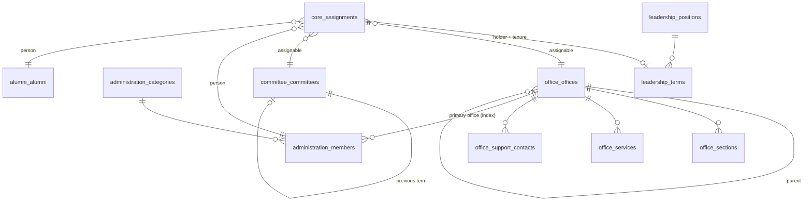

# Database Design
## DB-04 — Administration & People Modules (M-12 থেকে M-17)

| বিষয় | তথ্য |
|---|---|
| Document | Database Design DB-04 |
| Version | 1.3 — 2026-10-11 (v1.1): §11.1 legacy office-"department", support contact, admin → manual person (M-13 আসা পর্যন্ত); 2026-10-16 (v1.2): §4 Administration সরলীকরণ — contact visibility তিনটি column, campus ও user link পরে, Office scope, website গঠন; 2026-10-16 (v1.3): §6 Leadership — role holder / member, term-এর address, former, migration নেই |
| Date | 2026-10-08 |
| Status | ✔ Confirmed |
| Based on | [DB-01](01-DB-Core-Kernel.md), [DB-02](02-DB-Core-SiteBuilding.md), [SRS Part 3](../02-SRS/03-SRS-People.md), `project_diu` (row সংখ্যা `COUNT(*)`, 2026-10-08) |

> Convention: DB-01 Section 1, DB-02 Section 1। Slug, Media, SEO, Taxonomy, Relation, Assignment kernel থেকে (DB-03-এর শুরুর টেবিল দেখুন)।

### Module ও Prefix

| Module | Slug | Prefix | Person Source | Assignable | Dependency |
|---|---|---|---|---|---|
| M-12 Office | `office` | `office_` | — | Office, Section, Service, Support Contact | — |
| M-13 Administration | `administration` | `administration_` | ✔ | — | Office (optional → index) |
| M-14 | *একত্রিত — M-13-এ (BRD Q-25)* | — | — | — | — |
| M-15 Leadership | `leadership` | `leadership_` | — | Leadership Position | — |
| M-16 Committee | `committee` | `committee_` | — | Committee | — |
| M-17 Alumni | `alumni` | `alumni_` | ✔ | — | Department, Program, Faculty Member (optional → index) |

> **সংশোধন:** SRS-এ Leadership-কে "Person Source (manual person-এর জন্য)" বলা হয়েছিল। SAD ADR-14-এর পর manual person kernel-এর `core_manual_persons`-এ থাকে, তাই Leadership-কে আর Person Source হতে হয় না; Leadership একটি **Assignable** (পদ), এবং পদে যে ব্যক্তি থাকেন তিনি যেকোনো person source বা manual person থেকে আসেন।

---

## 1. Design: ব্যক্তি এক জায়গায়, ভূমিকা Assignment-এ

```
Person Source (ব্যক্তির মূল তথ্য)                 core_assignments (কোথায়, কী ভূমিকায়)
──────────────────────────────────                ─────────────────────────────────────────────
administration_members              ──┐                    office_offices          role: head, team
  (management, officer,      │                    office_sections         role: team
   support staff — সবাই)     │
faculty_member_profiles    ──┼─ person_type/id ─► office_services         role: responsible
alumni_alumni              ──┤                    office_support_contacts role: contact
core_manual_persons        ──┘                    leadership_positions    role: holder  (মেয়াদ = starts_on / ends_on)
                                                  committee_committees    role: chairman, member, member-secretary ...
                                                  faculty                 role: dean, associate_dean, officer, contact
                                                  department / program    role: head, coordinator, officer, contact, industry_expert
                                                  (সব role key: DB-01 Section 8.4 Standard Role Catalog)
                                                  admission_contact_groups role: contact
```

### `core_assignments`-এ একটি column যোগ (DB-01 সংশোধন)

| Column | Type | Key / N | বর্ণনা |
|---|---|---|---|
| note | JSON | N, T | Assignment-ভিত্তিক মন্তব্য — যেমন Committee member-এর "Nominated by UGC" (বর্তমান `committees.authority`) |

---

## 2. ERD



---

## 3. M-12 Office

### 3.1 `office_offices` — B (Relation Target, Microsite, Assignable)

| Column | Type | Key / N | Default | বর্ণনা |
|---|---|---|---|---|
| id | BIGINT UNSIGNED | PK | | Dynamic permission এই id দিয়ে (BRL-OFF-01) |
| parent_id | BIGINT UNSIGNED | N, FK self (restrict), IX | | ঐচ্ছিক parent Office |
| type_term_id | BIGINT UNSIGNED | N, FK core_terms (restrict), IX | | Vocabulary `office.type` (FR-OFF-01) |
| name | JSON | T | | |
| short_name | VARCHAR(50) | N | | |
| overview | JSON | N, T | | |
| head_message | JSON | N, T | | Head = Assignment `role_key = head` |
| email | VARCHAR(191) | N | | |
| phone, extension | VARCHAR(50), VARCHAR(20) | N | | |
| location | JSON | N, T | | |
| campus_id | BIGINT UNSIGNED | N, IX | | Campus optional |
| office_hours | JSON | N, T | | |
| has_microsite | TINYINT(1) | | 1 | বর্তমান `show_page` (FR-OFF-11) |
| sort_order | INT UNSIGNED | | 0 | |
| ⚙ | | | | |

IX: `(type_term_id, is_active, sort_order)`। Media: `logo`, `cover`।
Office তৈরি → `core_entity_permissions`-এ তিনটি permission (DB-01 §5.2)।

### 3.2 Office-এর Sub-table

সবগুলো B, `office_id` FK `office_offices` (**cascade**), `sort_order`।

| Table | Column (office_id, sort_order, ⚙ ছাড়া) | Assignable | SRS Ref |
|---|---|---|---|
| `office_sections` | `name` (T), `description` (T, N), `email`, `phone` N | ✔ (role `team`) | FR-OFF-04 |
| `office_services` | `title` (T), `description` (T, N), `required_documents` (T, N), `fee_note` (T, N), `fee_amount` DECIMAL(12,2) N, `processing_time` (T, N), `apply_url` N; Media `form` | ✔ (role `responsible`) | FR-OFF-06 |
| `office_support_contacts` | `purpose` (T), `location` (T, N) | ✔ (role `contact`) | FR-OFF-07 |

IX (প্রতিটিতে): `(office_id, is_active, sort_order)`। `office_services`-এ FULLTEXT নয় — `/services` search Global Search index দিয়ে।

---

## 4. M-13 Administration (BRD Q-25)

শিক্ষক ছাড়া সব employee — উচ্চ ব্যবস্থাপনা, কর্মকর্তা ও সহায়ক কর্মী — **একটি** table-এ। কে কোথায় কোন ভূমিকায় দেখাবেন তা `core_assignments` দিয়ে।

> *v1.2 (2026-10-16, build-এর আগে, সরলীকরণ):* `contact_visibility` JSON-এর বদলে তিনটি সাধারণ column `show_email`, `show_phone`, `show_extension` (form, filter ও query সহজ)। `campus_id` এখন নেই — M-08 Campus module এলে যোগ হবে। `user_id` (FR-ADMN-08, Could) এখন নেই — self-service profile পরে। Office scope (BRL-ADMN-02): Office user-এর list-এ primary Office তার scope-এ এমন member। Profile page `/administration/{slug}` (Settings › Administration-এ বন্ধ করা যায়); directory `/administration` — group / category / Office filter, নাম ও পদবি search, layout grid / list / table। Inactive member presenter-এ inactive, তাই সব assignment থেকে নিজে থেকেই লুকায় (FR-ADMN-09)।

### 4.1 `administration_categories` — B

একটি ক্রমযুক্ত তালিকা (উচ্চ → নিম্ন)। Taxonomy-র বদলে নিজস্ব table, কারণ `group` ও `is_public` business নিয়ম।

| Column | Type | Key / N | Default | বর্ণনা |
|---|---|---|---|---|
| id | BIGINT UNSIGNED | PK | | |
| name | JSON | T | | "Director", "Deputy Registrar", "Driver" |
| group | VARCHAR(20) | IX | | `management` / `officer` / `support` (FR-ADMN-02) |
| is_public | TINYINT(1) | | 1 | Directory-তে দেখাবে কিনা; `support`-এর default 0 |
| sort_order | INT UNSIGNED | IX | 0 | পুরো তালিকার ক্রম (Management প্রথমে) |
| ⚙ | | | | |

### 4.2 `administration_members` — B (Person Source)

| Column | Type | Key / N | Default | বর্ণনা |
|---|---|---|---|---|
| id | BIGINT UNSIGNED | PK | | |
| category_id | BIGINT UNSIGNED | FK administration_categories (restrict), IX | | |
| employee_id | VARCHAR(30) | N | | বর্তমান `admins.unique_id` |
| name | JSON | T | | |
| designation | JSON | N, T | | Free text: "Director (F & A)" |
| primary_office_id | BIGINT UNSIGNED | N, IX | | Office optional → FK নয় |
| ~~campus_id~~ | | | | *v1.2:* M-08 Campus-এর সাথে আসবে |
| email | VARCHAR(191) | N, IX | | Dedupe ও lookup |
| phone | VARCHAR(50) | N | | |
| extension | VARCHAR(20) | N | | |
| biography | JSON | N, T | | |
| show_email, show_phone, show_extension *(v1.2)* | TINYINT(1) | | 1, 1, 1 | Website-এ দেখাবে কিনা (FR-ADMN-07) |
| ~~user_id~~ | | | | *v1.2:* self-service (FR-ADMN-08) পরে |
| sort_order | INT UNSIGNED | | 0 | Category-র ভেতরে ক্রম |
| ⚙ | | | | |

UQ: `(employee_id, active_key)`। IX: `(category_id, is_active, sort_order)`, `(primary_office_id, is_active)`। Media: `photo`। Morph alias: `administration.member`।

Directory query: `administration_members JOIN administration_categories WHERE is_public = 1 ORDER BY administration_categories.sort_order, administration_members.sort_order`।

---

## 5. M-14 — *একত্রিত (M-13-এ)*

আলাদা table নেই।

---

## 6. M-15 Leadership

> *v1.3 (2026-10-16, build-এর সময়):* "একসাথে একজন" পদ (`is_single_holder`) kernel catalog-এর role `holder` (single holder) নেয়, বাকিগুলো `member` — তাই নতুন নিয়োগে আগের মেয়াদ শেষ করার নিয়ম Assignment engine-এরই (`endPrevious`, আগের দিন শেষ)। Term-এর web address ব্যক্তির নাম থেকে (`/leadership/{slug}`); `/leadership/former` = শেষ তারিখ পার হওয়া মেয়াদ। Website-এ term দেখায় যখন term, পদ ও assignment active + public এবং ব্যক্তি active। Legacy-তে leadership table নেই — migration step নেই; পদ ও পদধারী হাতে (Administration member বা manual person)।

### 6.1 `leadership_positions` — B (Assignable)

| Column | Type | Key / N | Default | বর্ণনা |
|---|---|---|---|---|
| id | BIGINT UNSIGNED | PK | | |
| title | JSON | T | | "Vice Chancellor" |
| group_term_id | BIGINT UNSIGNED | N, FK core_terms, IX | | Vocabulary `leadership.group` (Board of Trustees / Executive / Academic Leadership) |
| is_single_holder | TINYINT(1) | | 1 | একসাথে একজন current (FR-LEAD-07) |
| sort_order | INT UNSIGNED | | 0 | |
| ⚙ | | | | |

### 6.2 `leadership_terms` — B

পদে কে, কবে থেকে কবে পর্যন্ত — ব্যক্তি ও মেয়াদ `core_assignments`-এ; বার্তা ও biography এখানে।

| Column | Type | Key / N | Default | বর্ণনা |
|---|---|---|---|---|
| id | BIGINT UNSIGNED | PK | | |
| position_id | BIGINT UNSIGNED | FK leadership_positions (cascade), IX | | |
| assignment_id | BIGINT UNSIGNED | FK core_assignments (cascade), UQ | | ব্যক্তি + `starts_on` / `ends_on` (Former = `ends_on` অতীত, FR-LEAD-05) |
| message | JSON | N, T | | FR-LEAD-04/06 |
| biography | JSON | N, T | | Person source-এর biography override |
| ⚙ | | | | |

Homepage-এ কোন পদের বার্তা — Homepage section settings-এ `position_id` (FR-LEAD-06)। Highlight-এর প্রয়োজন নেই।

---

## 7. M-16 Committee — `committee_committees` — B (Assignable, Attachable)

| Column | Type | Key / N | Default | বর্ণনা |
|---|---|---|---|---|
| id | BIGINT UNSIGNED | PK | | |
| category_term_id | BIGINT UNSIGNED | N, FK core_terms, IX | | Vocabulary `committee.category` |
| name | JSON | T | | "Syndicate" |
| description | JSON | N, T | | |
| formed_on | DATE | N | | |
| term_starts_on, term_ends_on | DATE | N | | মেয়াদ (FR-COM-05) |
| previous_term_id | BIGINT UNSIGNED | N, FK self (set null) | | "Copy to new term" — archive chain |
| sort_order | INT UNSIGNED | | 0 | |
| published_at | TIMESTAMP | N | | |
| ⚙ | | | | |

* Member = `core_assignments` (`assignable = committee.committee`), `role_key` = Standard Role Catalog-এর Committee ভূমিকা (`chairperson` → `convener` → `member` → `member_secretary`; DB-01 Section 8.4), `note` = authority (যেমন "Nominated by UGC")।
* Owner entity (Department / Office / Lab-এর committee, FR-COM-04) = `core_relations` (Attachable)।
* Media: `order_pdf` (গঠন আদেশ)।

---

## 8. M-17 Alumni — `alumni_alumni` — B (Person Source)

| Column | Type | Key / N | Default | বর্ণনা |
|---|---|---|---|---|
| id | BIGINT UNSIGNED | PK | | |
| name | JSON | T | | |
| student_id | VARCHAR(30) | N | | |
| department_id | BIGINT UNSIGNED | N, IX | | Optional dependency → FK নয় |
| program_id | BIGINT UNSIGNED | N, IX | | Optional |
| batch | VARCHAR(30) | N, IX | | |
| passing_year | SMALLINT UNSIGNED | N, IX | | |
| current_designation | JSON | N, T | | |
| organization | JSON | N, T | | |
| job_type | VARCHAR(20) | N, IX | | `job` / `business` / `higher_study` / `other` |
| office_address | JSON | N, T | | |
| email, phone | VARCHAR(191), VARCHAR(50) | N | | |
| social_links | JSON | N | | `{facebook, x, linkedin}` |
| video_url | VARCHAR(2048) | N | | YouTube ইত্যাদি |
| story | JSON | N, T | | বিস্তারিত |
| is_pride | TINYINT(1) | IX | 0 | Pride Alumni (FR-ALUM-04) |
| faculty_member_id | BIGINT UNSIGNED | N, IX | | এখন শিক্ষক (FR-ALUM-08) |
| contact_visibility | JSON | N | | Default সব `false` (FR-ALUM-06) |
| submission_source | VARCHAR(20) | | `admin` | `admin` / `public_form` (FR-ALUM-07) |
| published_at | TIMESTAMP | N | | Public form-এর জমা `is_active = 0` অবস্থায় আসে; Alumni Office active করলে প্রকাশ (FR-ALUM-07) |
| sort_order | INT UNSIGNED | | 0 | |
| ⚙ | | | | |

UQ: `(student_id, active_key)`। IX: `(department_id, passing_year)`, `(program_id)`, IX-5। Media: `photo`, `video`।
Highlight (homepage): `core_relations` Main Site context — `is_pride` থেকে আলাদা (Pride একটি স্থায়ী পরিচয়; Highlight homepage-এর সাময়িক নির্বাচন)।

---

## 9. Vocabulary

| Key | Module | Ordered | বর্তমান উৎস |
|---|---|---|---|
| `office.type` | Office | | — (নতুন) |
| `leadership.group` | Leadership | ✔ | — (নতুন) |
| `committee.category` | Committee | | — (বর্তমান `committee_categories` আসলে committee; Section 11) |

---

## 10. Table সারসংক্ষেপ (DB-04)

| Module | Table | সংখ্যা |
|---|---|---|
| Office | office_offices, office_sections, office_services, office_support_contacts | ৪ |
| Administration | administration_categories, administration_members | ২ |
| Leadership | leadership_positions, leadership_terms | ২ |
| Committee | committee_committees | ১ |
| Alumni | alumni_alumni | ১ |
| **মোট** | | **১০** (+ `core_assignments`-এ একটি column) |

People module-এর table কম, কারণ ভূমিকা, সদস্যপদ, contact ও team — সব `core_assignments`-এ (SRS Part 3 Section 1)।

---

## 11. `project_diu` থেকে Migration Mapping

### 11.1 Table Mapping

| বর্তমান (row) | নতুন | রূপান্তর |
|---|---|---|
| `offices` (২৪) | office_offices | `title` → name, `slug` রাখা, `show_page` → has_microsite, `serial` → sort_order, `publication_status` → is_active; প্রতিটির জন্য dynamic permission তৈরি |
| *(2026-10-11)* legacy faculty "Office" ও "Institutional Programs"-এর ১২টি "department" (S04 বাদ রেখেছে) | office_offices | নাম / short name মিলিয়ে বিদ্যমান Office (Accounts Section → Accounts Office, Admission, CDC, Exam, Registrar, Transport, DSC Hall → Hall Office, HRDI) — id map-এ রাখা, যাতে তাদের FAQ ইত্যাদি সেই Office-এ যায়; না মিললে (DIL, DIUYSBC) নতুন Office; Ashulia ও Uttara Campus → Campus module (M-08), এখন report। এদের page / menu নেই |
| `sections` (১) + `section_employees` (২) | office_sections + core_assignments (`team`) | |
| `registrar_offices` (৪০) + categories (৭), `proctor_offices` (১৩) + categories (২) | page_pages (owner Office) + menu | DB-02 Section 18 |
| `admins` (৬০৩) | administration_members | `unique_id` → employee_id, `admin_category_id` → category_id, `office_id` (১১৪টিতে আছে) — *(2026-10-11 যাচাই: এটি office নয়, ৯ অঙ্কের employee code যেমন 710003029)* → employee_id-এর সাথে মিলিয়ে দেখা (S11); Office team আসে `office_admins` থেকে, `campus` text → campus_id (Campus match) |
| `admin_categories` (১১) | administration_categories | `group` = `management` (Management) বা `officer` (বাকি); `serial` → sort_order |
| `office_admins` (১৫, সবগুলো `admin_id` সহ) | core_assignments (Office, `team`) | Person = সংশ্লিষ্ট staff member; row-এর নিজস্ব phone / extension আলাদা হলে `overrides`-এ |
| `coordination_officers` (৭৩: ৩১টি `admin_id` সহ, ৪২টি ছাড়া) | core_assignments (Department বা Program, `coordinator`) | `admin_id` থাকলে staff member; না থাকলে Section 11.2 অনুযায়ী match, না মিললে manual person; `department_program_name` text → Program match |
| `support_contacts` (২২: ২১টি `admin_id` সহ) | office_support_contacts + core_assignments (`contact`) | `purpose` → purpose, `office_location` → location; একই office ও purpose-এর একাধিক row = একটি support contact-এ একাধিক ব্যক্তি |
| *(2026-10-11)* ব্যক্তি (`admin_id`) — Administration module (M-13) আসার আগে | core_manual_persons | `admins`-এর নাম, পদবি, email, phone থেকে একজন manual person **প্রতি admin একবার** (S08, S10 একই id map ভাগ করে); M-13 এলে S11 এদের staff member-এ রূপান্তর করবে |
| `contacts` (১১৪: ৮টি `admin_id` সহ, ১০৬টি ছাড়া) | core_assignments (Faculty / Department) | `contact_type` → Standard Role Catalog (DBQ-03 confirmed): **১ = Dean** (৭) → Faculty, `role_key = dean`; **২ = Head** (৪০) → Department, `role_key = head`; **৩ = Officer** (৬৭) → Faculty বা Department (`faculty_id` / `department_id` অনুযায়ী), `role_key = officer`; `designation` মূল লেখা ভিন্ন হলে `role_label`-এ; person Section 11.2 অনুযায়ী |
| `staff` (৩৭৯), `staff_categories` (৫) | administration_members, administration_categories | একই table-এ; category `group` = `support`, `is_public` = 0, sort_order `admin_categories`-এর পরে; `campus` text → campus_id; `admins`-এর সাথে একই ব্যক্তি থাকলে Section 11.2 অনুযায়ী merge |
| `committee_categories` (১৩) | **committee_committees** | বর্তমান "category"-ই আসলে committee (Syndicate, Academic Council ...) |
| `committees` (১৭৫) | core_assignments (Committee) + person | বর্তমান "committee" row আসলে **সদস্য**: `title` / `designation` / `phone` / `email` → person (match বা manual), `position` (free text) → Committee role key-তে map (Chairman / Chairperson → `chairperson`, Member Secretary → `member_secretary`, Convener → `convener`, বাকি → `member`; মূল লেখা ভিন্ন হলে `role_label`-এ রাখা), `authority` → note, `header` → role_label (দলভিত্তিক শিরোনাম), `serial` → sort_order |
| `lab_committees` (১৮) | committee_committees + assignment (Lab-এর owner relation) | DB-06 |
| `alumnis` (৬৯৭) | alumni_alumni | `pride_alumni` (১১৬) → is_pride; `is_faculty` (৩৭) → পরে Faculty Member-এর সাথে match; `job_type` (৬৮৯টি খালি) → null; `is_home = 1` (৬০২) → `site:0` relation (main site-এ প্রকাশিত; highlight নয় — DB-05 Section 1, BRD Q-26); homepage highlight admin Pride Alumni থেকে নতুন করে বাছবে; `name_slug` → core_slugs; `video_type` / `video_url` / `video_file` → video_url বা Media |

### 11.2 একই ব্যক্তির Duplicate একত্রীকরণ (Person Dedupe)

বর্তমান DB-তে একই ব্যক্তি একাধিক table-এ, এবং `admins`-এর ভেতরেই একই নামের **২১টি group** আছে।

**ধাপ:**

1. **Person candidate তৈরি:** `admins`, `staff`, `alumnis`, এবং `admin_id` ছাড়া row (`coordination_officers` ৪২, `contacts` ১০৬, `committees` ১৭৫, `support_contacts` ১) থেকে।
2. **Match key (অগ্রাধিকার ক্রমে):**
   1. `admin_id` থাকলে সরাসরি সেই staff member।
   2. Normalized email (ছোট হাতের, trim)।
   3. Normalized phone (বাংলাদেশ format: `+8801XXXXXXXXX`; extension বাদ)।
   4. Normalized নাম + পদবি (শুধু প্রস্তাব, স্বয়ংক্রিয় merge নয়)।
3. **স্বয়ংক্রিয় merge** শুধু ধাপ ১–৩-এ; ধাপ ৪ ও `admins`-এর ভেতরের ২১টি নাম-group → **Merge review sheet** (DIU HR / Registrar যাচাই করবে)।
4. কোনো মিল না পেলে → `core_manual_persons`।
5. Merge-এর পর assignment-এর row-ভিত্তিক phone / extension মূল তথ্য থেকে আলাদা হলে `overrides`-এ রাখা হয় (তথ্য হারায় না)।
6. Faculty Member data (`faculty-diu` বা অন্য উৎস) এলে ধাপ ২–৩ আবার চালিয়ে manual person → faculty member-এ রূপান্তর।

**ফলাফল report:** কতজন স্বয়ংক্রিয় merge, কতজন review-এ, কতজন manual person — migration dry-run-এর অংশ।

---

## 12. খোলা প্রশ্ন

| # | প্রশ্ন | প্রস্তাব |
|---|---|---|
| DBQ-03 *(✔ সমাধান)* | বর্তমান `contacts.contact_type` (১ = ৭, ২ = ৪০, ৩ = ৬৭ row)-এর অর্থ কী? | ১ = Dean, ২ = Head, ৩ = Officer → Standard Role Catalog key `dean`, `head`, `officer` (DB-01 Section 8.4) — অন্য university-র জন্যও একই standard |
| DBQ-04 | `admins`-এর ভেতরের ২১টি একই-নাম group এবং অমিল person-এর merge review কে করবেন? | DIU HR বা Registrar Office |
