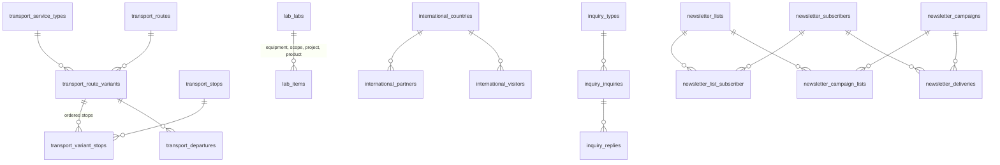

# Database Design
## DB-06 — Campus & Services, Reputation & Partnership, Communication (M-31 থেকে M-39)

| বিষয় | তথ্য |
|---|---|
| Document | Database Design DB-06 |
| Version | 1.4 — 2026-10-17 (v1.1): §2 Transport চালু system-এর API থেকে; 2026-10-17 (v1.2, owner: পুরোনো system বাদ যাবে): §2 Transport নিজের table-এ — `route_group`, variant / departure-এর `days_off`, চলমান service settings-এ, একই গঠনের public API, S18T; 2026-10-17 (v1.3): §3–§8, §10 build-এর আগের সংশোধন (application standard — `published_at` নয়, Media Library, Person Picker, "Show in"; website, section, legacy step); 2026-10-17 (v1.4, build): §3 `lab_labs` + `email`, `phone`; §5 `subject_key` NOT NULL default '' (unique-এ NULL কখনো মেলে না, IX-8), settings `expired` / `notify_days`; §6 partner model = `Institution` (M-37 Partners-এর permission থেকে আলাদা নাম), settings ও notification একই; §10 `newsletter_deliveries.status` + `skipped`; সব step S18F/S18C/S18L/S18P/S18R/S18I/S18N |
| Date | 2026-10-08 |
| Status | ✔ Confirmed |
| Based on | [DB-01](01-DB-Core-Kernel.md), [DB-02](02-DB-Core-SiteBuilding.md), [DB-05](05-DB-Content.md) (Main site প্রকাশ), [SRS Part 5](../02-SRS/05-SRS-Services.md), `project_diu` (row সংখ্যা `COUNT(*)`, 2026-10-08) |

> Convention: DB-01 Section 1, DB-02 Section 1। Content-ধরনের table-এর common column (published_at, expires_at, sort_order, ⚙) ও Main site প্রকাশ: DB-05 Section 1–2।

### Module ও Prefix

| Module | Slug | Prefix | Relation Target / Microsite | Attachable | Dependency (FK নীতি) |
|---|---|---|---|---|---|
| M-31 Transport | `transport` | `transport_` | — | — | Campus (optional → index) |
| M-32 Lab / Research Center | `lab` | `lab_` | ✔ / ✔ | — | Department, Campus (optional → index) |
| M-33 Facilities | `facilities` | `facilities_` | — | ✔ | Campus (optional → index) |
| M-34 Accreditation & Ranking | `accreditation` | `accreditation_` | — | ✔ | — |
| M-35 International Linkage & Conference | `international` | `international_` | — | ✔ | Gallery (optional → index) |
| M-36 CSR | `csr` | `csr_` | — | ✔ | — |
| M-37 Partners | `partners` | `partners_` | — | ✔ | — |
| M-38 Contact / Inquiry | `inquiry` | `inquiry_` | — | — | Office (optional → index) |
| M-39 Newsletter | `newsletter` | `newsletter_` | — | — | — |

---

## 1. ERD



---

## 2. M-31 Transport

> **v1.2 (2026-10-17, owner):** "পুরোনো system বাদ দিয়ে দিবো, তাই transport module এখানেই বানাতে হবে।" v1.1-এর "নিজের table নয়, live API পড়া" বাতিল — M-31 নিজেই data রাখে (§2.2 table, নিচের সংশোধন সহ), admin-এ entry, legacy থেকে migration (S18T)। **একই গঠনের public API** `GET /api/v2/public/transport` দেয় (DIU-র এখনকার frontend শুধু ঠিকানা বদলে আমাদের data পড়তে পারে)।
>
> * **Service type** (Regular, Final Exam, Mid-Term, Semester Break …; একটি default) — **কোনটি এখন চলছে** Settings › Transport-এ বাছাই (legacy `transport_services.is_active`); `is_active` = তালিকায় আছে কিনা।
> * **Route** — `route_group` (`regular` / `shuttle` / `friday` — website-এর tab, legacy `tag`), map, বার্তা, ক্রম। **Variant** = route × service type: ক্রমযুক্ত stop, `days_off` (যেদিন চলে না, legacy `day_of_week`), বার্তা। **Departure** = variant-এর একটি সময়: direction (`to_campus` / `from_campus`), `trip_type` (`regular` / `shuttle`), `days_off`। Website ও API-তে একটি route-এর **চলমান service-এর variant**, না থাকলে default service-এর; কোনোটি না থাকলে route দেখায় না।
> * Settings › Transport: চলমান service, schedule-এর শিরোনাম ("Special Transport Schedule for Exam-2026"), semester, নিয়মনীতি PDF (Media Library), এবং page-এর লেখা — পরিচিতি, Transport Pass, Transport Fees table (v1.1 থেকে)।
> * Website `/transport` (v1.1-এর মতো, data নিজের table থেকে), route finder (FR-TRN-06), homepage section `transport.finder`। Admin: Transport › Routes (variant: stop drag, সময় একসাথে অনেক), Stops (map-এর latitude / longitude), Service types।
> * Legacy (S18T): `transport_services` (৪), `stops` (১৭৮, deleted বাদ), `roads` (২০) + `road_stop` + `road_schedule` + `schedules` → default service-এর variant; `road_services` + `road_service_stop` + `road_service_schedule` → সেই service-এর variant; `transport_settings` → settings (+ PDF S03-এর পরে)।

### 2.1 গঠন

বর্তমান system-এ একটি route-এর "regular" সময়সূচি (`roads` + `road_stop` + `road_schedule`) এবং বিশেষ service-এর আলাদা সময়সূচি (`road_services` + `road_service_stop` + `road_service_schedule`) — দুই রকম table। নতুন design-এ দুটিই একই ধারণা: **Route Variant** = একটি route × একটি service type × সপ্তাহের দিন, যার নিজস্ব ক্রমযুক্ত stop ও departure সময়।

```
Route "Mirpur" ─┬─ Variant: Regular Service, Sat–Thu ── stops [Mirpur-10 → ... → Campus] ── departures 07:00, 07:30 (to_campus) ...
                ├─ Variant: Regular Service, Friday   ── ...
                └─ Variant: Final Exam Service        ── stops [...] ── departures ...
```

### 2.2 Table

| Table | শ্রেণী | Column (⚙ ছাড়া) | Key | Ref |
|---|---|---|---|---|
| `transport_service_types` | B | `name` (T), `code` VARCHAR(50), `is_default` TINYINT(1), `sort_order` | UQ `(code, active_key)` | FR-TRN-03 |
| `transport_stops` | B | `name` (T), `latitude`, `longitude` DECIMAL(10,7) N, `landmark` (T, N), `sort_order` | IX `(is_active)` | FR-TRN-01 |
| `transport_routes` | B | `name` (T), `code` VARCHAR(30) N, `route_group` VARCHAR(10) (`regular` / `shuttle` / `friday`; *v1.2: `tag`-এর বদলে*), `campus_id` N (index), `map_url` N, `message` (T, N), `sort_order` | UQ `(code, active_key)`; IX `(route_group, sort_order)` | FR-TRN-02 |
| `transport_route_variants` | B | `route_id` (FK cascade), `service_type_id` (FK transport_service_types restrict), `days_off` JSON (`["Friday"]` — *v1.2: চলার দিনের বদলে যেদিন চলে না, legacy-র মতো*), `message` (T, N) | UQ `(route_id, service_type_id, active_key)`; IX `(service_type_id, route_id)` | FR-TRN-04/09 |
| `transport_variant_stops` | P | `variant_id` (FK cascade), `stop_id` (FK transport_stops restrict), `sort_order` SMALLINT, timestamps | UQ `(variant_id, stop_id)`; IX `(stop_id)` (route finder) | FR-TRN-02/06 |
| `transport_departures` | B | `variant_id` (FK cascade), `direction` VARCHAR(12) (`to_campus` / `from_campus`), `departs_at` TIME, `trip_type` VARCHAR(10) (`regular` / `shuttle`), `days_off` JSON N (*v1.2*), `stop_times` JSON N (stop-প্রতি আনুমানিক সময়), `sort_order` | IX `(variant_id, direction, departs_at)` | FR-TRN-04 |

* **Route finder (FR-TRN-06):** `transport_variant_stops WHERE stop_id = ?` → চলমান service-এর variant → departures (website-এ stop-এর নাম লিখে খোঁজা)।
* Driver assignment (FR-TRN-10): `transport_routes` Assignable (`role_key = driver`)।
* Transport policy / rules file, schedule-এর শিরোনাম, semester, চলমান service: `core_settings` (group `transport`) + Media (`policy_file`)।

---

## 3. M-32 Lab / Research Center

> **v1.3 (2026-10-17, build-এর আগে — application standard):** Lab = microsite entity (Office-এর মতো): `/lab/{slug}` (Department থাকলে তার নিচে — kernel microsite parent), relation target (News, Events, Gallery, Slider, Partners … "Show in" দিয়ে), dynamic permission `Manage:Lab#{id}`, Homepage / Menu / Header & Footer / Statistics kernel থেকে। `type_term_id` → `HasTaxonomy` (`lab.type`); `category_term_id` → `HasTaxonomy` (item type অনুযায়ী vocabulary)। দায়িত্বপ্রাপ্ত = Person Picker (`in_charge`; legacy `assign_person_*` → manual person)। Logo, cover, item-এর ছবি Media Library-তে। Project ও Product-এর details page `/lab/{slug}/projects/{item}`। Website: `/labs` (ধরন, Department; grid / list / cards)। Legacy S18L: `lab_facilities` (১১৩) → lab, `lab_tools` / `lab_scopes` / `lab_projects` / `lab_products` + category → item, `lab_articles` (৯) → lab-এর Page, `lab_mid_sections` (৪) → homepage feature; lab-এর gallery / slider / news / partner / committee — সেই module-এর step-এ lab relation (S03-এর পরে ছবি)।

### 3.1 `lab_labs` — B (Relation Target, Microsite, Assignable)

| Column | Type | Key / N | বর্ণনা |
|---|---|---|---|
| id | BIGINT UNSIGNED | PK | Dynamic permission এই id দিয়ে |
| type_term_id | BIGINT UNSIGNED | N, FK core_terms, IX | Vocabulary `lab.type` (Teaching Lab / Research Lab / Research Center / Innovation Hub) |
| department_id | BIGINT UNSIGNED | N, IX | Department optional → FK নয় |
| name | JSON | T | |
| short_name | VARCHAR(50) | N | |
| campus_id | BIGINT UNSIGNED | N, IX | |
| location | JSON | N, T | Building, room |
| summary | JSON | N, T | |
| body | JSON | N, T | |
| equipment_summary | JSON | N, T | বর্তমান `instrument` |
| video_url | VARCHAR(2048) | N | |
| website_url | VARCHAR(2048) | N | External website |
| sort_order | INT UNSIGNED | | |
| ⚙ | | | |

দায়িত্বপ্রাপ্ত ব্যক্তি: `core_assignments` (`role_key = in_charge`)। Media: `logo`, `cover`। Lab তৈরি → `core_entity_permissions`।

### 3.2 `lab_items` — B

চার ধরনের sub-item (Equipment, Scope / Service, Student Project, Product) — গঠন প্রায় একই, তাই একটি table।

| Column | Type | Key / N | বর্ণনা |
|---|---|---|---|
| id | BIGINT UNSIGNED | PK | |
| lab_id | BIGINT UNSIGNED | FK lab_labs (cascade) | |
| item_type | VARCHAR(20) | | `equipment` / `scope` / `project` / `product` |
| category_term_id | BIGINT UNSIGNED | N, FK core_terms | Vocabulary `lab.{item_type}-category` (সব Lab-এ shared) |
| title | JSON | T | |
| description | JSON | N, T | |
| quantity | INT UNSIGNED | N | Equipment |
| student_names | JSON | N, T | Project |
| student_ids | VARCHAR(255) | N | Project |
| options | JSON | N | যেমন scope-এর display side |
| sort_order | INT UNSIGNED | | |
| ⚙ | | | |

IX: `(lab_id, item_type, is_active, sort_order)`। Project ও Product-এর details page → `core_slugs` (FR-LAB-10)। Media: `image`।

Lab-এর news, event, gallery, slider, committee, research, partner, page, menu, homepage, statistics — kernel ও সংশ্লিষ্ট module-এ (SRS FR-LAB-07/08/09)।

---

## 4. M-33 Facilities — `facilities_facilities` — B (Attachable)

> **v1.3 (build-এর আগে):** `published_at` নয় — `is_active`; `icon` VARCHAR-এর বদলে Media `icon` (ছবি / SVG; legacy CSS class বাদ)। কোথায় = "Show in" + main site। Website `/facilities`, `/{entity}/facilities` (category; icon grid / cards / list), `/facilities/{slug}` (`body` থাকলে, নইলে `external_url`-এ)। Homepage section `facilities.list` "Campus Facilities" (source mode)। Legacy S18F: `facilities` (৭৬; `facilityable` / `department_id` → relation, `is_home` → main site)।

| Column | Type | Key / N | বর্ণনা |
|---|---|---|---|
| id | BIGINT UNSIGNED | PK | |
| title | JSON | T | |
| summary | JSON | N, T | |
| body | JSON | N, T | Details page (FR-FCL-03) |
| icon | VARCHAR(100) | N | |
| external_url | VARCHAR(2048) | N | |
| open_in_new_tab | TINYINT(1) | | |
| campus_id | BIGINT UNSIGNED | N, IX | |
| + common | | published_at, sort_order |

Entity সংযোগ (Program, Department, Lab ...) → `core_relations`। Vocabulary: `facilities.category`। Media: `image`, `gallery`।

---

## 5. M-34 Accreditation & Ranking

> **v1.3 (build-এর আগে):** দুটি table-ই attachable; `published_at` নয় — `is_active`। Accreditation: `expires_on` পার হলে setting অনুযায়ী লুকানো অথবা "Expired" (FR-ACR-02)। Ranking: একই `agency_key`-এর বছরভিত্তিক তালিকা = trend (FR-ACR-04)। Website `/accreditations` (category), `/rankings` (সর্বশেষ বছর আগে, সংস্থা অনুযায়ী trend table)। Program page-এ সংশ্লিষ্ট accreditation tab। Homepage section `accreditation.recognition` "Rankings & Recognition" (logo strip)। Legacy S18R: `accreditations` (১৫) + categories (২), `rankings` (৬১; `agency_key` title থেকে — review)।

| Table | শ্রেণী | Column (⚙ ও common ছাড়া) | Key | Ref |
|---|---|---|---|---|
| `accreditation_accreditations` | B (Attachable) | `title` (T), `agency` (T), `body` (T, N), `website_url` N, `category_term_id` (N, vocabulary `accreditation.category`), `awarded_on` DATE N, `expires_on` DATE N IX; Media `logo`, `certificate` | IX `(expires_on)` (মেয়াদ notification) | FR-ACR-01/02 |
| `accreditation_rankings` | B (Attachable) | `agency_key` VARCHAR(50) IX (`qs`, `the`, `webometrics` — trend group), `agency_name` (T), `year` SMALLINT, `scope` VARCHAR(20) (`overall` / `subject` / `region`), `subject` (T, N), `rank_label` VARCHAR(30) ("801–1000"), `rank_value` INT N (sort / trend-এর জন্য সংখ্যা), `summary` (T, N), `body` (T, N), `ranking_url` N; Media `logo`, `badge` | UQ `(agency_key, year, scope, subject_key, active_key)`*; IX `(agency_key, year)` | FR-ACR-03/04 |

\* `subject_key` VARCHAR(100) N — subject-এর স্থির key (JSON `subject`-এ unique index সম্ভব নয়)।

Program / Department / Faculty-তে accreditation (বর্তমান `department_program_type_id`, `is_faculty`, `is_department`) → `core_relations`।

---

## 6. M-35 International Linkage & Conference

> **v1.3 (build-এর আগে):** `published_at` নয় — `is_active`। Visitor-এর `name` / `designation` / `organization` free text থাকে (বিদেশি অতিথি, directory-তে নেই)। `category_term_id` → `HasTaxonomy`। Website `/international/partners` (দেশ, চুক্তি, খোঁজা; logo grid / table / country list), `/international/conferences`, `/international/visitors`। Partner CSV import (FR-INTL-07)। Metric `international.partners`, `international.countries`। Homepage section `international.partners` "Global Partners" (Highlight আগে — featured)। Legacy S18I: `countries` (৭৯ → ISO code), `international_linkages` (৭১৭, চুক্তির ধরন `other`), `featured_partners` (২৭) → main site Highlight, `international_conferences` (৯) + categories (৩), `visitors` (১৭৮)।

| Table | শ্রেণী | Column (⚙ ও common ছাড়া) | Key | Ref |
|---|---|---|---|---|
| `international_countries` | C | `name` (T), `iso2` CHAR(2), `is_active`, timestamps; Media `flag` | UQ `(iso2)` | FR-INTL-01 |
| `international_partners` | B (Attachable) | `name` (T), `country_id` (FK international_countries restrict), `website_url` N, `agreement_type` VARCHAR(20) IX (`mou` / `moa` / `exchange` / `dual_degree` / `research` / `other`), `signed_on` DATE N, `expires_on` DATE N IX, `description` (T, N); Media `logo` | IX `(country_id, agreement_type)` | FR-INTL-01/02/03 |
| `international_conferences` | B (Attachable) | `title` (T), `body` (T, N), `category_term_id` (N, vocabulary `international.conference-category`), `starts_on`, `ends_on` DATE N, `venue` (T, N), `website_url` N, `organizer_label` (T, N); Media `image` | IX `(starts_on)` | FR-INTL-05 |
| `international_visitors` | B (Attachable) | `name` (T), `designation` (T, N), `organization` (T, N), `country_id` (N, FK international_countries set null), `visited_on` DATE IX, `body` (T, N), `is_external` TINYINT(1), `album_id` N (index — Gallery optional); Media `photo` | | FR-INTL-06 |

Featured partner (বর্তমান `featured_partners`) → Highlight (`core_relations`, FR-INTL-04)।

---

## 7. M-36 CSR — `csr_activities` — B (Attachable)

> **v1.3 (build-এর আগে):** `published_at` নয় — `is_active` + `active_at`। Category-র ছবি = term-এর Media use (`image`), বিবরণ `core_terms.description`। Website `/csr` (category card) → `/csr/category/{slug}` → `/csr/{slug}`; layout card / grid / timeline। Homepage section `csr.list` "Social Responsibility"। Legacy S18C: `csr_categories` (৭, parent) → `csr.category`, `csrs` (১১৯; `is_home` → main site, `is_featured` → Highlight)।

| Column | Type | Key / N | বর্ণনা |
|---|---|---|---|
| id | BIGINT UNSIGNED | PK | |
| title | JSON | T | |
| body | JSON | N, T | |
| external_url | VARCHAR(2048) | N | |
| video_url | VARCHAR(2048) | N | |
| occurred_on | DATE | N, IX | |
| + common | | published_at, sort_order |

Vocabulary: `csr.category` (hierarchical; category-র ছবি Media, সংক্ষিপ্ত বিবরণ `core_terms.description`)। Media: `image`, `gallery`।

---

## 8. M-37 Partners — `partners_partners` — B (Attachable)

> **v1.3 (build-এর আগে):** `published_at` নয় — `is_active`; `valid_until` পার হলে লুকায় (FR-PRT-04); `category_term_id` → `HasTaxonomy`। Website `/partners` (ধরন tab), `/student-discounts` (category ও icon)। Homepage section `partners.list` "Industry Partners" (logo carousel)। Legacy S18P: `discount_partners` (৬৩) + categories (১২) → `discount`; `mps` (১২০) + `mps_categories` (৪) → ধরন category থেকে, `lab_facility_id` → Lab relation, `is_international`। Homepage seeder-এর `partner.list` → `partners.list`।

| Column | Type | Key / N | বর্ণনা |
|---|---|---|---|
| id | BIGINT UNSIGNED | PK | |
| partner_type | VARCHAR(20) | IX | `industry` / `sponsor` / `membership` / `discount` / `other` |
| name | JSON | T | |
| website_url | VARCHAR(2048) | N | |
| description | JSON | N, T | |
| category_term_id | BIGINT UNSIGNED | N, FK core_terms | Discount category (vocabulary `partners.discount-category`, icon সহ) |
| discount_value | JSON | N, T | "20% off" |
| discount_terms | JSON | N, T | |
| valid_from, valid_until | DATE | N, IX (valid_until) | FR-PRT-04 |
| is_international | TINYINT(1) | | বর্তমান `mps.is_international` |
| + common | | published_at, sort_order |

Lab / Department / Program-এর partner → `core_relations` (FR-PRT-03)। Media: `logo`।

---

## 9. M-38 Contact / Inquiry

| Table | শ্রেণী | Column (⚙ ছাড়া) | Key | Ref |
|---|---|---|---|---|
| `inquiry_types` | B | `name` (T), `office_id` N (index — default Office), `recipient_emails` JSON N, `auto_reply_subject` (T, N), `auto_reply_body` (T, N), `sort_order` | | FR-INQ-02/05 |
| `inquiry_inquiries` | B | `type_id` (FK inquiry_types restrict), `name` VARCHAR(191), `email` VARCHAR(191), `phone` VARCHAR(50) N, `subject` VARCHAR(255), `message` TEXT, `source_url` VARCHAR(2048) N, `source_type`, `source_id` (N — P-20, যে microsite থেকে এসেছে), `locale` VARCHAR(10), `status` VARCHAR(20) IX (`new` / `in_progress` / `replied` / `closed` / `spam`), `assigned_user_id` (N, FK users set null), `ip_address` VARCHAR(45) N, `user_agent` VARCHAR(512) N, `closed_at` TIMESTAMP N IX; Media `attachment` | IX `(source_type, source_id, status)`, `(type_id, status, created_at)` | FR-INQ-03/06/08 |
| `inquiry_replies` | B | `inquiry_id` (FK cascade), `user_id` (FK users), `body` TEXT, `is_internal_note` TINYINT(1), `sent_at` TIMESTAMP N | IX `(inquiry_id, created_at)` | FR-INQ-06/07 |

* Routing: source entity (P-20) থাকলে সেই entity-র user; না থাকলে type-এর Office / recipient email (FR-INQ-02/08)।
* Personal data retention (FR-INQ-09): `status = closed` এবং `closed_at` ২৪ মাসের পুরনো → **force delete** (soft delete নয়, কারণ উদ্দেশ্য ব্যক্তিগত তথ্য মুছে ফেলা)।
* Activity log-এ শুধু id ও status পরিবর্তন (BRL-INQ-01)।

---

## 10. M-39 Newsletter

> **v1.3 (build-এর আগে):** Subscribe form = Livewire (footer block `newsletter.subscribe` — kernel footer block hook; page block); double opt-in mail (queue); one-click unsubscribe (signed link, কারণ ঐচ্ছিক); List / Subscriber CRUD, CSV import / export; Campaign → queue-তে throttled (প্রতি মিনিটে setting অনুযায়ী), test email, report। Admission subscriber sync (FR-NLT-08) — Admission module থাকলে `admission-updates` list। Legacy S18N: `newsletters` (৬,৬২৪; `subscription_status` → subscribed / unsubscribed, source `legacy`, `general` list)।

| Table | শ্রেণী | Column (⚙ ছাড়া) | Key | Ref |
|---|---|---|---|---|
| `newsletter_lists` | B | `key` VARCHAR(50) (`general`, `admission-updates`, `notices`), `name` (T), `description` (T, N), `is_public` TINYINT(1), `sort_order` | UQ `(key, active_key)` | FR-NLT-04/08 |
| `newsletter_subscribers` | B | `email` VARCHAR(191), `name` VARCHAR(191) N, `status` VARCHAR(20) IX (`pending` / `subscribed` / `unsubscribed` / `bounced`), `token` CHAR(64), `verified_at` TIMESTAMP N, `source` VARCHAR(30) (`footer`, `admission`, `import`, `legacy`), `unsubscribed_at` TIMESTAMP N, `unsubscribe_reason` VARCHAR(255) N | UQ `(email, active_key)`; UQ `(token)` | FR-NLT-01/02/03, BRL-NLT-01 |
| `newsletter_list_subscriber` | P | `list_id` (FK cascade), `subscriber_id` (FK cascade), `subscribed_at`, `unsubscribed_at` N | PK `(list_id, subscriber_id)` | BRL-NLT-01 |
| `newsletter_campaigns` | B | `subject` VARCHAR(255), `locale` VARCHAR(10), `body` LONGTEXT, `source_url` N, `source_label` N (News / Notice থেকে তৈরি হলে), `scheduled_at` N, `sent_at` N, `send_status` VARCHAR(20) IX (`draft` / `scheduled` / `sending` / `sent` / `failed`), `sent_count`, `failed_count`, `bounce_count` INT UNSIGNED | | FR-NLT-05/06 |
| `newsletter_campaign_lists` | P | `campaign_id` (FK cascade), `list_id` (FK restrict) | PK দুটি মিলে | FR-NLT-05 |
| `newsletter_deliveries` | L | `campaign_id` (FK cascade), `subscriber_id` (FK cascade), `status` VARCHAR(20), `error` VARCHAR(500) N, `sent_at` | UQ `(campaign_id, subscriber_id)`; IX `(status)` | FR-NLT-06 |

* **Suppression (BRL-NLT-02):** `unsubscribed` subscriber row থেকে যায়; import একই email পেলে status পরিবর্তন করে না।
* `newsletter_deliveries` বড় হয় (subscriber × campaign) — ৯০ দিন পর মুছে যায়, campaign-এর count থেকে যায়।
* Admission subscriber (DB-03 `admission_subscribers`) → Newsletter active থাকলে `admission-updates` list-এ sync।

---

## 11. Vocabulary

| Key | Module | Hierarchical | বর্তমান উৎস |
|---|---|---|---|
| `lab.type` | Lab | | — |
| `lab.equipment-category`, `lab.scope-category`, `lab.project-category`, `lab.product-category` | Lab | | `lab_tool_categories` (৪), `lab_scope_categories` (৩), `lab_project_categories` (২), `lab_product_categories` (২) |
| `facilities.category` | Facilities | | — |
| `accreditation.category` | Accreditation | | `accreditation_categories` (২) |
| `international.conference-category` | International | | `international_conference_categories` (৩) |
| `csr.category` | CSR | ✔ | `csr_categories` (৭) |
| `partners.discount-category` | Partners | | `discount_partner_categories` (১২) |

---

## 12. Table সারসংক্ষেপ (DB-06)

| Module | Table | সংখ্যা |
|---|---|---|
| Transport | transport_service_types, transport_stops, transport_routes, transport_route_variants, transport_variant_stops, transport_departures | ৬ |
| Lab | lab_labs, lab_items | ২ |
| Facilities | facilities_facilities | ১ |
| Accreditation | accreditation_accreditations, accreditation_rankings | ২ |
| International | international_countries, international_partners, international_conferences, international_visitors | ৪ |
| CSR | csr_activities | ১ |
| Partners | partners_partners | ১ |
| Inquiry | inquiry_types, inquiry_inquiries, inquiry_replies | ৩ |
| Newsletter | newsletter_lists, newsletter_subscribers, newsletter_list_subscriber, newsletter_campaigns, newsletter_campaign_lists, newsletter_deliveries | ৬ |
| **মোট** | | **২৬** |

---

## 13. `project_diu` থেকে Migration Mapping

| বর্তমান (row) | নতুন | রূপান্তর |
|---|---|---|
| `transport_services` (৪: Regular, Final Exam, Mid-Term Exam, Semester Break) | transport_service_types | `code`, `is_default` অপরিবর্তিত; legacy `is_active` = চলমান service → settings (v1.2) |
| `stops` (১৭৮) | transport_stops | |
| `roads` (২০) + `road_stop` (১৬১) + `road_schedule` (৬৭) | transport_routes + default-service variant + variant stops + departures | `tag` → `route_group`; `day_of_week` → variant `days_off` (v1.2); stop-এর ক্রম = `road_stop.id`; `road_services` (২০) + `road_service_stop` + `road_service_schedule` → সেই service-এর variant |
| `road_services` (২০) + `road_service_stop` (১৫৭) + `road_service_schedule` (৯৬) | বিশেষ service-এর variant (বর্তমান data-তে শুধু `final_exam_service`) | |
| `schedules` (৩৭, deleted বাদ ১৮) | transport_departures (variant-প্রতি copy — legacy-তে road-গুলো একই সময় share করত) | `direction`: `from_home` → `to_campus`, `from_campus` → `from_campus`; `schedule_type` → trip_type; `time` → departs_at; `day_of_week` → `days_off` |
| `transport_settings` (১) | core_settings (`transport`) + Media | `title`, `semester`, `rules_policy_file` (S03-এর পরে) |
| `lab_facilities` (**১১৩**) | lab_labs | `department_id` → department_id; `instrument` → equipment_summary; `assign_person_*` → manual person বা Administration match + assignment (`in_charge`); `promotional_video` → video_url; `website_link` → website_url; `student_feedback` → body-র একটি section অথবা testimonial (manual review); প্রতিটির জন্য dynamic permission |
| `lab_tools` (২৯), `lab_scopes` (৬), `lab_projects` (৭), `lab_products` (২) | lab_items (`item_type` অনুযায়ী) | Category table → vocabulary; category-র `lab_ids` (কোন Lab-এ দেখাবে) বাদ — vocabulary shared |
| `lab_menus` (১৫), `lab_app_menus` (৮) | menu (DB-02) | |
| `lab_mid_sections` (৪), `lab_section_summaries` (১) | homepage_sections (Lab owner) | |
| `lab_management_categories` (৪) + `lab_committees` (১৮) | committee_committees (Lab relation) + assignment | DB-04 |
| `lab_galleries` (৫৬৪), `lab_news` (১), `lab_research` (৩), `lab_articles` (৯) | DB-05 | |
| `mps` (১২০) + `mps_categories` (৪) | partners_partners (Lab relation) | `mps_categories` → `partner_type` mapping (DIU যাচাই, Section 14); `is_international` অপরিবর্তিত |
| `facilities` (৭৬: ৭০টি Program-এর, ৬টি সাধারণ) | facilities_facilities | Program-এর ৭০টি → Program relation; ৬টি → `site:0` (main site); `facility_icon`, `facility_link`, `target` → icon, external_url, open_in_new_tab |
| `accreditations` (১৫) + categories (২) | accreditation_accreditations | `department_program_type_id` / `is_faculty` / `is_department` → relation |
| `rankings` (৬১) | accreditation_rankings | `title` থেকে agency_key ও rank_label parse (manual যাচাই); `is_home` → `site:0` |
| `countries` (৭৯) | international_countries | ISO code যোগ (country নাম থেকে) |
| `international_linkages` (৭১৭) | international_partners | **ঝুঁকি:** ৮১টি আলাদা `country_id` ব্যবহৃত, কিন্তু `countries`-এ ৭৯টি row — অমিল reference আগে ঠিক করতে হবে (Section 14); `agreement_type` বর্তমান data-তে নেই → default `mou`, পরে সম্পাদনা |
| `featured_partners` (২৭) | Highlight (`site:0`, `is_highlighted`) | `international_linkage_id` → partner; `serial` → highlight_order |
| `international_conferences` (৯) + categories (৩) | international_conferences | |
| `visitors` (১৭৮: external ১৪৩, internal ৩৫) | international_visitors | `is_external` অপরিবর্তিত; `department_id` → relation; `is_home` → `site:0`; `country` text → country_id match |
| `csrs` (১১৯) + `csr_categories` (৭) | csr_activities + `csr.category` | `photo`, `photo_two` → gallery Media; `is_home` → `site:0`; `is_featured` → highlight |
| `discount_partners` (৬৩) + categories (১২) | partners_partners (`discount`) + vocabulary | `discount_value`, `details`, `website` |
| `newsletters` (৬,৬২৪; সবগুলো active) | newsletter_subscribers + `general` list | `status = subscribed`, `source = legacy`, `verified_at` = migration-এর সময় — সরাসরি shift, আবার confirm চাওয়া হবে না (DBQ-07 confirmed) |
| `admission_subscribers` (৪,৮২৮) | `admission-updates` list (DB-03 থেকে sync) | একই email `newsletters`-এও থাকলে একটি subscriber, দুটি list |
| Contact form inquiry | — | বর্তমান DB-তে inquiry table নেই; নতুন করে শুরু |

---

## 14. খোলা প্রশ্ন

| # | প্রশ্ন | প্রস্তাব |
|---|---|---|
| DBQ-05 | `international_linkages`-এর কিছু `country_id` `countries` table-এ নেই (৮১ বনাম ৭৯)। এগুলো কোন দেশ? | Migration dry-run-এ অমিল row-এর তালিকা দিয়ে DIU International Affairs-কে যাচাই করতে দেওয়া |
| DBQ-06 | `mps_categories`-এর ৪টি category কী (Membership, Partner, Sponsor ...)? | DIU যাচাই করে `partner_type`-এ map |
| DBQ-07 *(✔ সমাধান)* | পুরনো ৬,৬২৪ জন newsletter subscriber-কে নতুন system-এ আবার confirm email পাঠানো হবে, নাকি সরাসরি subscribed? | **সরাসরি shift, কোনো confirm email নয়** (DIU confirmed): `status = subscribed`, `source = legacy`; `admission_subscribers` (৪,৮২৮)-এর জন্যও একই নিয়ম। প্রতিটি email-এ unsubscribe link থাকবে (FR-NLT-03) |

---

## 15. Database Design — সামগ্রিক সারসংক্ষেপ

| Document | বিষয় | Table |
|---|---|---|
| [DB-01](01-DB-Core-Kernel.md) | Kernel ও System core | ১৮টি সারি (Laravel ও spatie-এর system table সহ; Standard Role Catalog যোগ) |
| [DB-02](02-DB-Core-SiteBuilding.md) | Site-building core | ২৮টি সারি (`core_approvals` বাদ) |
| [DB-03](03-DB-Academic.md) | Academic | ৪৪ (v1.1: `waiver_category_includes`; v1.7: `faculty_member_profile_items` JSON column-এ) |
| [DB-04](04-DB-People.md) | People | ১০ |
| [DB-05](05-DB-Content.md) | Content | ১৬ |
| [DB-06](06-DB-Services.md) | Services, Reputation, Communication | ২৬ |

বর্তমান `project_diu`-এর ~১৮০টি table-এর তুলনায় business table অনেক কম, কারণ:

* প্রতিটি entity-র আলাদা menu, article, gallery, slider, committee, video table → kernel-এর একটি করে ব্যবস্থা (Relation, Menu, Pages, Media)।
* একই ব্যক্তির তথ্য ৭টি table-এ → Person Source + Assignment।
* Category table-গুলো (প্রায় ৩০টি) → একটি Taxonomy।
